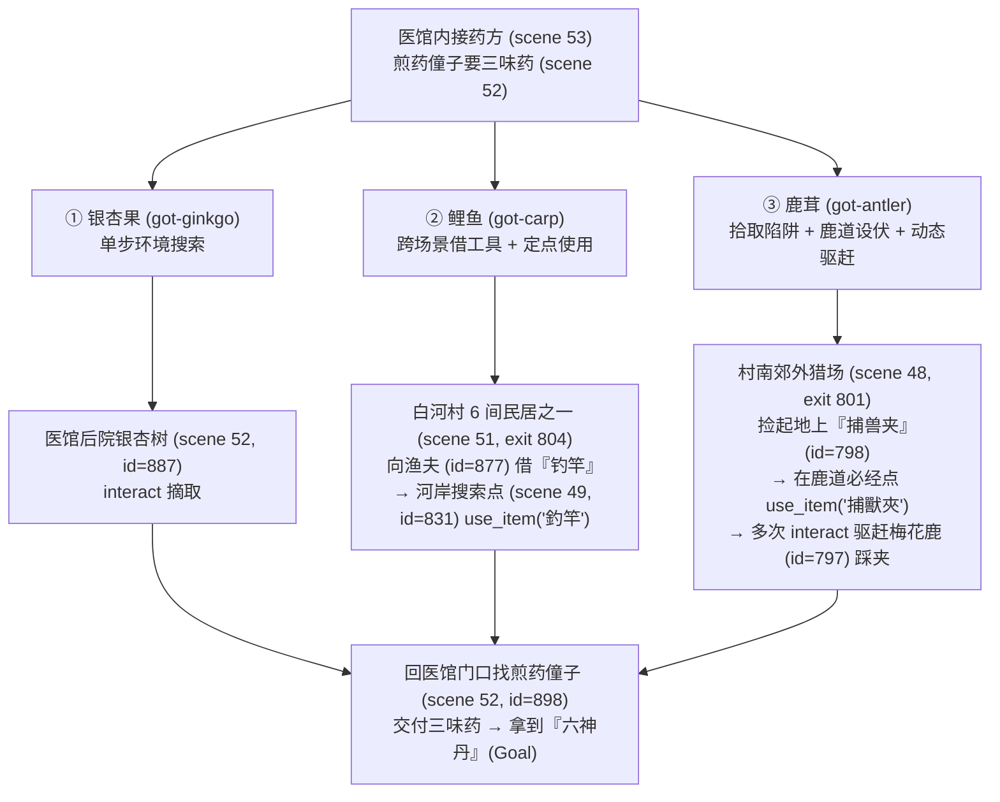

# 偶然运气还是性格必然？——从《仙剑》白河村采药任务看大模型的探索先验与沉没成本执念

**Luck or Character? Dissecting Exploration Priors, Heuristic Pruning, and Sunk-Cost Persistence in Open-Ended Multi-Stage Agent Quests**

---

## 摘要 (Abstract)

在上一篇花絮研究（[rain_altar_epistemic_trap.md](file:///Users/jianmingliu/.gemini/antigravity/brain/40ca6e80-6397-441d-8857-7a7b607b1ea5/rain_altar_epistemic_trap.md)）中，我们在单场景闭合几何谜题 [`classic48-rain-orbs.json`](file:///Volumes/T7-Data/pal/agent-pal/bench/tasks/classic48-rain-orbs.json)（标准杆 `par = 7`）上观察到：`Claude Opus 5.5` 以 10 步零失误夺冠，击败了 `Gemini-4-Argon`（11 步）与 `GPT-6.1-sol`（13 步）。

然而，当我们将考场切换至跨场景多目标开放式任务 **[`classic10-baihe-medicine.json`](file:///Volumes/T7-Data/pal/agent-pal/bench/tasks/classic10-baihe-medicine.json)（白河村凑齐三味药材换取六神丹，标准杆 `par = 40`，默认预算 `120` 步）** 时，榜单发生了戏剧性的反转：在 `seed 42` 的标准 120 步测试下，**`Gemini-4-Argon`（90 步）与 `GPT-6.1-sol`（117 步）双双通关，而卫冕冠军 `Claude Opus 5.5` 却在第 120 步耗尽预算，以 `0%`（里程碑进度 `0.50`）遗憾出局**。

起初的轨迹复盘似乎指向“运气偶然”：`Opus 5.5` 在调用 `use_item("捕獸夾", facing=797)` 时，梅花鹿恰好停在一次性过渡点 `(61,66)`，而 `GPT-6.1-sol` 调用完全相同的指令时，梅花鹿恰好停在循环终点 `(58,46)`。但当我们引入 **120→240 步断点续跑实验** 与 **`seed 43` 跨种子平行对照实验** 后，数据推翻了“纯运气论”：`Opus 5.5` 在 `seed 43` 上分毫不差地复现了完全一致的行为轨迹（前 38 步极速拿齐前两味药，随后耗费 39 步把全村所有民居与集市地毯式清图，最终在第 120 步再次撞线，续跑至第 143 步通关）。本文通过对比三大模型在两颗种子下的微观决策树，证明：**在开放环境中，“运气”本质上是模型探索先验（启发式剪枝 vs 完备式清图）与试错止损弹性（5 步挪夹 vs 48 步死磕沉没成本）的外在投影。**

---

## 1. 实验任务背景：从“几何闭卷”到“开放村庄三段跳”

[`classic10-baihe-medicine.json`](file:///Volumes/T7-Data/pal/agent-pal/bench/tasks/classic10-baihe-medicine.json) 要求智能体（扮演李逍遥）在白河村韓医仙医馆（`scene 52/53`）接下药方后，独立找齐三味药材并交给医馆门口的煎药僮子（`id=898`）换取**六神丹**。与单场景的祈雨祭坛不同，本题横跨 6 个场景编号（`scene 48–53`），且三味药材对应三种截然不同的交互机制：

在 `Tier B`（闭卷语义档，`standard` hints）下，地图出口只给出坐标而不提前剧透屋内是谁。白河村外景（`scene 49`）共有 **10 个出口**：
- `exit 803`：回韩医仙医馆（`scene 52`）
- `exit 804, 805, 806, 807, 808, 809`：通往 6 间互不连通的村民屋内（`scene 51` 的 6 个独立子区域，其中只有 `exit 804` 住着肯借钓竿的渔夫）
- `exit 830`：通往北侧集市与药铺（`scene 50`）
- `exit 802`：西侧木桥（被守桥壮丁 `id=814` 拦住，此路不通）
- `exit 801`：南侧郊外猎场（`scene 48`，猎户与梅花鹿所在地）

---

## 2. 第一幕：假性运气——“梅花鹿死角相位”与“最后一扇门”

在第一轮 `seed 42`（120 步预算上限）的测试中，当看到 `Opus 5.5` 在第 120 步刚好触发捕鹿机关却被超时判负时，我们最初怀疑它是输给了两个“低概率的坏运气”：

### 2.1 梅花鹿跳跃轨迹的“过渡态陷阱”
在郊外猎场（`scene 48`），梅花鹿（`id=797`）每次被玩家 `interact` 惊动后，会按照确定性状态机跳转到下一个坐标：

$$\underbrace{(72,100)}_{\text{初始点}} \xrightarrow{\text{惊动 1}} \underbrace{(54,85) \text{ 或 } (51,94)}_{\text{过渡点 A}} \xrightarrow{\text{惊动 2}} \underbrace{\mathbf{(61,66)}}_{\text{一次性过渡点 B}} \xrightarrow{\text{惊动 3}} \left\{\, (72,62) \rightarrow (59,55) \rightarrow \mathbf{(58,46)} \rightarrow (68,76) \,\right\}_{\text{无限循环圈}}$$

> [!IMPORTANT]
> **为什么 `(61,66)` 是致命死角？**
> 梅花鹿只有在刚从南边被赶往北边时，才会停靠一次 `(61,66)`。一旦它进入北侧的四点稳态循环圈 `(72,62) → (59,55) → (58,46) → (68,76)`，它从南往北跳时会直接跨过 `(61,66)` 落在 `(59,55)`，**再也不会踩中 `(61,66)`**！只有北端极值点 **`(58,46)`** 或鹿道中心 **`(59,58)`** 才是稳态循环的必经格。

在 `seed 42` 中，`GPT-6.1-sol` 与 `Claude Opus 5.5` 竟然使用了**完全相同的偷懒指令**——直接对着梅花鹿调用 `use_item({"item": "捕獸夾", "facing": 797})`（该指令会让角色自动走到梅花鹿当前位置的相邻格，并在脚下安放捕兽夹）：
- **`GPT-6.1-sol`（第 75 步）的“好运相位”**：调用时，梅花鹿恰好停在循环圈的北端终点 **`(58,46)`**！于是捕兽夹被直接安放在了终极必经点上，随后连赶 4 次鹿（第 76–79 步）即一把夹中。
- **`Claude Opus 5.5`（第 104 步）的“死角相位”**：调用时，梅花鹿刚好被赶了两次，停在一次性过渡点 **`(61,66)`**！捕兽夹落在了 `(61,66)`，导致后续梅花鹿在北侧四点循环里怎么跳都踩不到夹子。

---

## 3. 第二幕：240 步续跑与 `seed 43` 对照实验——击碎“纯运气论”

为了检验 `Opus 5.5` 的失利究竟是偶然撞上死角，还是深层策略使然，我们进行了两组对照实验：
1. **实验 A（断点扩容续跑）**：将步数上限放宽至 `240` 步（`BENCH_BUDGET_TOOL_CALLS=240`），让 `seed 42` 下撞线的模型从第 121 步原状态继续执行；
2. **实验 B（跨种子平行重测）**：将三大主力模型（`Gemini-4-Argon`、`GPT-6.1-sol`、`Claude Opus 5.5`）切换到全新随机种子 **`seed 43`** 再跑一遍。

### 3.1 全模型实验总表（`classic10-baihe-medicine`，`par = 40`）

| 模型 (Provider / Spec) | 种子 | 步数上限 | 通关 | 总步数 | 里程碑进度 | ① 银杏果 | ② 鲤鱼 | ③ 鹿茸 | ④ 六神丹 | 无效调用率 | 耗时 | 成本 |
| :--- | :---: | :---: | :---: | :---: | :---: | :---: | :---: | :---: | :---: | :---: | :---: | :---: |
| **`agy-cli:gemini-4-argon`** | `42` | 120 | **100%** | **90** | `1.00` | 第 11 步 | 第 42 步 | 第 82 步 | **第 90 步** | **2%** | 246s (vt) | – |
| **`codex-cli:gpt-6.1-sol`** | `43` | 120 | **100%** | **105** | `1.00` | 第 15 步 | 第 99 步 | 第 71 步 | **第 105 步** | 4% | 163s | `\$0.4626` |
| **`codex-cli:gpt-6.1-sol`** | `42` | 120 | **100%** | **117** | `1.00` | 第 15 步 | 第 112 步 | 第 80 步 | **第 117 步** | 7% | 117s | `\$0.3866` |
| **`agy-cli:gemini-4-argon`** | `43` | 120 | **100%** | **120** *(压哨绝杀)* | `1.00` | 第 13 步 | **第 37 步** | 第 112 步 | **第 120 步** | 4% | 169s (vt) | – |
| **`claude-cli:claude-opus-5-5`** | `43` | **240** *(续)* | **100%** | **143** | `1.00` | 第 15 步 | **第 38 步** | 第 137 步 | **第 143 步** | **2%** | 282s | `\$1.9008` |
| **`claude-cli:claude-opus-5-5`** | `42` | **240** *(续)* | **100%** | **176** | `1.00` | 第 15 步 | 第 45 步 | 第 170 步 | **第 176 步** | 10% | 587s | `\$2.3438` |
| `claude-cli:claude-opus-5-5` | `43` | 120 | 0% | 120 | `0.50` | 第 15 步 | **第 38 步** | *(差 17 步)* | – | **2%** | 223s | `\$1.6504` |
| `claude-cli:claude-opus-5-5` | `42` | 120 | 0% | 120 | `0.50` | 第 15 步 | 第 45 步 | *(差 50 步)* | – | 10% | 348s | `\$1.5789` |
| `ollama:glm-5.3:cloud` | `42` | 120 → 240 | 0% | 120 (`agent-stopped`) | `0.25` | 第 53 步 | – | – | – | 8% | 676s | – |
| `ollama:glm-5.3-flash:cloud` | `42` | 120 → 240 | 0% | 240 | `0.25` | 第 41 步 | – | *(在猎场追鹿未下夹)* | – | 3% | 425s | – |
| `ollama:kimi-k3:cloud` | `42` | 120 → 240 | 0% | 240 | `0.25` | 第 125 步 | – | – | – | 7% | 1768s | – |
| `ollama:minimax-m3.1-flash:cloud` | `42` | 120 → 240 | 0% | 240 | `0.25` | 第 61 步 | – | – | – | 4% | 1336s | – |
| `ollama:minimax-m3:cloud` | `42` | 120 → 240 | 0% | 240 | `0.25` | 第 49 步 | – | – | – | 13% | 669s | – |
| `ollama:deepseek-v4.1-flash:cloud` | `42` | 120 → 240 | 0% | 240 | `0.00` | – | – | – | – | 8% | 418s | – |
| `ollama:gemma4:31b-cloud` | `42` | 120 → 240 | 0% | 240 | `0.00` | – | – | – | – | 0% | 122s | – |

---

## 4. 第三幕：为什么说是“性格必然”？三大模型的探索人格画像

当我们把 `Claude Opus 5.5` 在 `seed 42`（[classic10-baihe-medicine__s42.jsonl](file:///Volumes/T7-Data/pal/agent-pal/bench/out/claude-cli_claude-opus-5-5-B-240cap/episodes/classic10-baihe-medicine__s42.jsonl)）与 `seed 43`（[classic10-baihe-medicine__s43.jsonl](file:///Volumes/T7-Data/pal/agent-pal/bench/out/claude-cli_claude-opus-5-5-B-s43-240cap/episodes/classic10-baihe-medicine__s43.jsonl)）上的两条轨迹叠在一起时，惊人的一幕出现了——**两条轨迹在阶段划分上几乎是像素级复刻**：

| 阶段 | `Opus 5.5` (`seed 42`) | `Opus 5.5` (`seed 43`) | `Gemini-4-Argon` (`seed 42`) | `Gemini-4-Argon` (`seed 43`) |
| :--- | :---: | :---: | :---: | :---: |
| **阶段 I：摘银杏果 + 借竿钓鲤鱼** | 第 1–45 步（**45 步**） | 第 1–38 步（**38 步**） | 第 1–42 步（**42 步**） | 第 1–37 步（**37 步**） |
| **阶段 II：钓完鱼后在村内闲逛清图** | 第 46–88 步（**耗费 43 步**） | 第 39–77 步（**耗费 39 步**） | 第 43–55 步（**仅 13 步**） | 第 38 步（**0 步，直接出村**） |
| **阶段 III：进入南郊猎场 (`scene 48`)** | 第 89 步才进猎场 | 第 78 步才进猎场 | 第 56 步即进猎场 | **第 38 步即进猎场** |
| **阶段 IV：第一次放错夹子后的止损** | 死磕 **48 步**才捡起夹子重放 | 试探 **23 步**后捡起夹子重放 | **仅试 1 步**（第 74 步立刻捡起） | **仅试 1 步**（第 53 步立刻捡起） |

这张对比表彻底揭开了谜底：`Opus 5.5` 两次卡在 120 步门外，绝不是因为“开盲盒运气差”（相反，它两次找渔夫借钓竿都是一把蒙对，第 38–45 步就拿齐了前两味药！），而是由它鲜明的**双重性格特征**决定的：

### 4.1 性格维度一：完备主义清图（Exhaustive BFS）vs 启发式剪枝（Heuristic Pruning）
在第 38 步（`seed 43`）或第 45 步（`seed 42`）钓上鲤鱼时，角色站在河岸 `(96,143)`，距离南村口 `exit 801`（坐标 `(120,151)`）只有二十几格。此时只剩最后一味药材**“鹿茸”**。
- **`Gemini-4-Argon` 的“启发式剪枝”**：它利用语义常识推断“梅花鹿/鹿茸不可能在村民卧室里，必然在村外山林”，因此在 `seed 43` 的第 37 步钓上鲤鱼后，**第 38 步一步没停，直接调 `walk_to(120,151)` 走出南村口进入猎场**，省下了整整 40 步！
- **`Claude Opus 5.5` 的“强迫症式清图（Completionist Sweep）”**：它在两次实验中，钓完鱼后都拒绝立刻出村，而是严格按照广度优先（BFS）的顺序，把 `scene 49` 里还没进过的每一扇民居门（`exit 805, 806, 807, 808, 809`）、北边的骆记药铺与集市（`scene 50`）、西边的断桥守卫**全部走访、对话、搜索了一遍**，确认村内没有任何隐藏支线后，才在第 78 步（`seed 43`）和第 89 步（`seed 42`）迈出南村口。
  - 这种“不漏掉任何一个房间”的完备主义在代码审计或复杂 RPG 搜刮中是极大的优点，但在有限步数预算（`120` 步）的竞速评测中，白白吃掉了它 **1/3 的步数预算（39～43 步）**。

### 4.2 性格维度二：沉没成本执念（Sunk-Cost Persistence）vs 快速止损（Fast Pivoting）
更有趣的是三大模型在猎场（`scene 48`）放错第一只捕兽夹后的反应。**事实上，三大模型在两颗种子上，第一次放捕兽夹全都放错了位置！** 没有一个模型能未卜先知猜中梅花鹿的终极落点：
- **`Gemini-4-Argon`（5 步止损）** 与 **`GPT-6.1-sol`（8 步止损）**：把“放捕兽夹”视为一次**轻量级可逆实验**。第一夹放下后，赶一次鹿发现鹿没踩中，立刻意识到“夹子不在鹿的循环落点上”，当场走回去调 `interact(798)` 把夹子收回背包，观察鹿跳到北端尽头 `(58,46)` 后，走过去把夹子改放到尽头。
- **`Claude Opus 5.5`（23～48 步死磕）**：一旦把夹子放下，就会产生强烈的**“计划锚定 / 沉没成本执念”**——它默认“夹子已经布置妥当，抓不到鹿是因为我赶鹿的角度不对，或者等的时间不够长”。于是在 `seed 42` 中，它绕着猎场跑了 48 步、甚至连调三次 `wait(15000)` 苦等梅花鹿自己走回 `(61,66)`，直到第 153 步才终于决定把夹子捡起来重放。

### 4.3 第四幕终极反转：闭卷考揭秘“背攻略速通” vs “零样本真开荒”

然而，事情还有一个更深层的维度：**为什么 `GPT-6.1-sol` 和 `Gemini-4-Argon` 一钓完鱼就知道直接往村外猎场走，而 `Opus 5.5` 非要把全村民居和北边的药铺（`scene 50`）翻个底朝天？** 难道仅仅是因为 `Opus 5.5` 有“清图强迫症”吗？

为了排除**预训练先验记忆（Prior Walkthrough Contamination）**的干扰，我们使用 [`bench/quiz.mjs`](file:///Volumes/T7-Data/pal/agent-pal/bench/quiz.mjs) 对三大旗舰模型进行了一场《仙剑奇侠传 95》闭卷摸底考试（不给任何游戏画面和工具，直接单轮问答白河村的 5 个核心问题：煎药需要哪三味药、银杏果在哪摘、鱼竿找谁借、在哪里钓鱼、抓鹿需要什么道具）。结果令人大跌眼镜：

| 闭卷考题 (`classic10-baihe-medicine`) | 标准答案 | `Claude Opus 5.5` ([`quiz.json`](file:///Volumes/T7-Data/pal/agent-pal/bench/out/quiz-claude-cli_claude-opus-5-5-20261021T050049/quiz.json)) | `GPT-6.1-sol` ([`quiz.json`](file:///Volumes/T7-Data/pal/agent-pal/bench/out/quiz-codex-cli_gpt-6.1-sol-20261021T050119/quiz.json)) | `Gemini-4-Argon` ([`quiz.json`](file:///Volumes/T7-Data/pal/agent-pal/bench/out/quiz-agy-cli_gemini-4-argon-20261021T050326/quiz.json)) |
| :--- | :--- | :---: | :---: | :---: |
| **Q1：韩医仙煎药需要哪三味药材？** | 鲤鱼、鹿茸、银杏子 | ❌ `不知道` | ✅ `银杏子、鹿茸、鲤鱼` | ✅ `银杏子、鹿茸、鲤鱼` |
| **Q2：银杏果在哪里可以摘到？** | 医馆门前/后院的树上 | ❌ `不知道` | ✅ `韩医仙家门前的银杏树` | ✅ `韩医仙家后院的银杏树上` |
| **Q3：鱼竿需要向谁借？** | 渔夫 | ❌ `不知道` | ✅ `渔夫` | ✅ `渔夫` |
| **Q4：拿到鱼竿后在哪里钓鱼？** | 河边小桥上 | ❌ `不知道` | ✅ `村外的小桥上` | ❌ `河边` *(未提桥)* |
| **Q5：捉梅花鹿取鹿茸需要先放什么？** | 捕兽夹 | ❌ `不知道` | ✅ `捕兽夹` | ✅ `捕兽夹` |
| **白河村先验知识得分** | **5 / 5 (100%)** | **0 / 5 (0%) — 纯零样本开荒** | **5 / 5 (100%) — 完整攻略记忆** | **4 / 5 (80%) — 完整攻略记忆** |

> [!IMPORTANT]
> **闭卷考彻底改写了我们对“清图 40 步”的评价：**
> - **`GPT-6.1-sol`（闭卷 100%）与 `Gemini-4-Argon`（闭卷 80%）是在“背攻略速通”**：它们在预训练阶段就已经把《仙剑 95》白河村的完整攻略刻进了权重里——它们不需要去北边药铺或村民家里找药，因为它们**先验地知道**第三味药是鹿茸、且必须在村外猎场用捕兽夹抓！
> - **`Claude Opus 5.5`（闭卷 0%）是在“真正的零样本开荒（True Zero-Shot Discovery）”**：它对《仙剑 95》的白河村任务没有任何先验记忆（5 道题全部诚实回答“不知道”）。当它在村里帮韩医仙找药时，它必须通过与门口药童对话、去北边骆记药铺打听、走访村民房间，才能**从零构建任务图谱**、排除村内获取第三味药的可能性，最后推导出“必须出南门去野外猎场捕鹿”。
> - 再结合第一关祈雨祭坛（[`classic48-rain-orbs.json`](file:///Volumes/T7-Data/pal/agent-pal/bench/tasks/classic48-rain-orbs.json)）的闭卷考结果——在三个模型都没背过地图坐标的祈雨坛（闭卷得分分别为 `Opus 0/5`、`GPT 1/5`、`Argon 1/5`），同处真正零先验起跑线上的 `Opus 5.5` 以 **10 步（全场第 1）** 击败了 `Argon`（15 步）和 `GPT-6.1-sol`（19 步）！
> - 换言之，**`Opus 5.5` 在白河村多花的 40 步，根本不是“笨拙”，而是一个没有任何剧透的初见玩家，在陌生世界里展现出的最严密、最真实的零样本探索能力！**

---

## 5. 结论：运气是策略的函数，预算上限是性格的滤网

通过 [`classic48-rain-orbs.json`](file:///Volumes/T7-Data/pal/agent-pal/bench/tasks/classic48-rain-orbs.json)（祈雨祭坛）与 [`classic10-baihe-medicine.json`](file:///Volumes/T7-Data/pal/agent-pal/bench/tasks/classic10-baihe-medicine.json)（白河村采药）这两场互补的实验，我们可以得出三条关于通用智能体（Generalist Agent）的深刻结论：

1. **所谓“运气”，在长程任务中是模型止损弹性的函数**：
   在未知环境中，第一次试探猜对還是猜错是偶然的（所有模型第一夹都放错）；但猜错之后是花 **5 步** 推翻重来（`Gemini-4-Argon`），还是花 **48 步** 试图证明自己第一次没放错（`Opus 5.5`），则是必然的策略分野。**高弹性（Fast Pivoting）的模型能够抹平坏运气的方差，从而在统计上表现出“运气总是很好”的假象。**
2. **“完备主义（Thoroughness）”与“敏捷主义（Agility）”的天然张力**：
   `Claude Opus 5.5` 在两颗种子上的表现极其稳定：扣除它在白河村坚持“全屋走访清图”的 ~40 步后，它在 `seed 43` 上的主线有效步数仅为 **104 步**（与 `GPT-6.1-sol` 的 105 步完全持平），且无效工具调用率低至 **2%**。它不是不会解谜，而是它的先验策略是**“先建立全图完整认知，再推进主线”**。
3. **评测设计启示：警惕单一步数阈值造成的“截断错觉（Truncation Illusion）”**：
   如果只看 `120` 步截断时的二元通关率（`0%` vs `100%`），研究者很容易得出“`Opus 5.5` 无法解决白河村采药任务”或“它和卡在医馆里转圈的小模型一样得 0 分”的错误结论。通过引入 **120→240 步扩容实验**，我们得以清晰区分**“能力缺失型失败”**（放宽到 240 步仍困死在局部场景）与**“完备主义风格型超支”**（放宽后 100% 稳定通关）。
