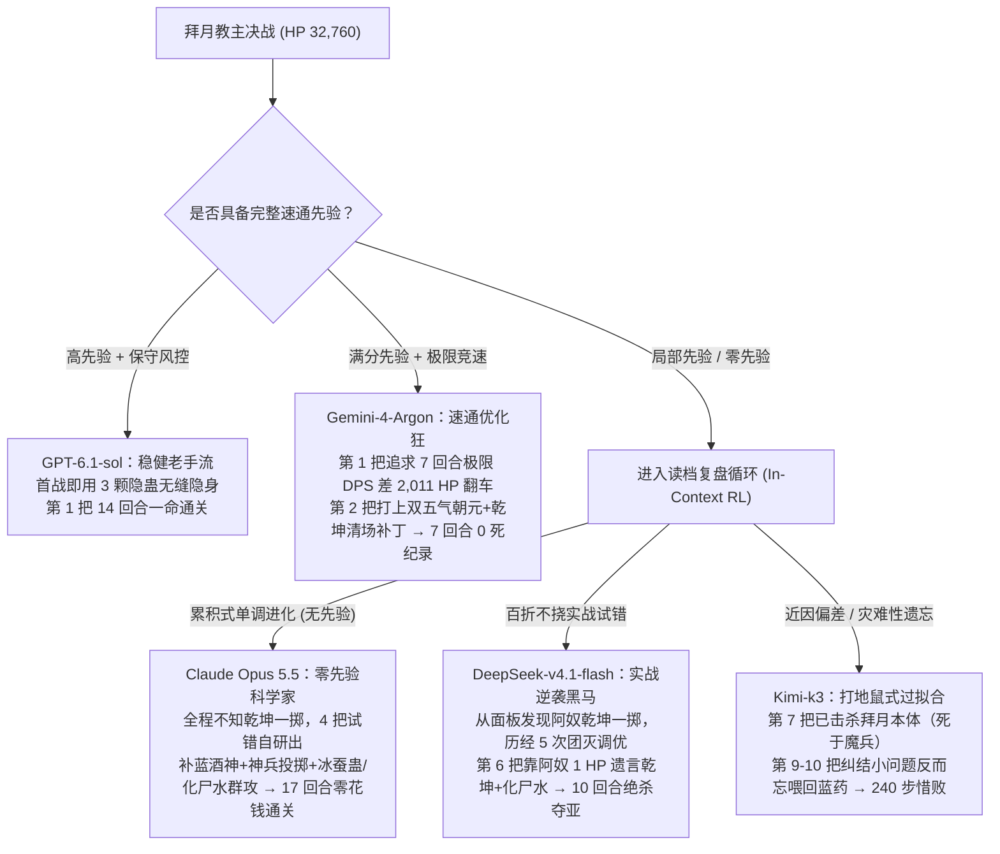

# 先验套路还是败后复盘？——从《仙剑》拜月决战看大模型的记忆污染与上下文强化学习

> **《仙剑奇侠传 95》智能体评测三部曲 · 终章**
> - **第一篇（静态认知闭环）**：[从《仙剑》祈雨祭坛看大模型的“认知闭环”与“盲目试错”](file:///Volumes/T7-Data/pal/agent-pal/docs/rain-altar-epistemic-trap.zh.md)（[`classic48-rain-orbs.json`](file:///Volumes/T7-Data/pal/agent-pal/bench/tasks/classic48-rain-orbs.json)）
> - **第二篇（动态环境止损）**：[运气偶然还是性格必然？——从《仙剑》白河村采药与跨种子复现实验看大模型的探索人格](file:///Volumes/T7-Data/pal/agent-pal/docs/baihe-luck-vs-character.zh.md)（[`classic10-baihe-medicine.json`](file:///Volumes/T7-Data/pal/agent-pal/bench/tasks/classic10-baihe-medicine.json)）
> - **第三篇（高压数值博弈与复盘进化）**：本文（[`baiyue-single-origin.json`](file:///Volumes/T7-Data/pal/agent-pal/bench/tasks/baiyue-single-origin.json) + [`bench/quiz.mjs`](file:///Volumes/T7-Data/pal/agent-pal/bench/quiz.mjs)）

---

## 1. 引言：当智能体站在最终 Boss 面前，我们究竟在测什么？

在前两场实验中，我们考察了大模型在**空间符号解谜**（祈雨祭坛）与**长程动态搜集**（白河村采药）中的表现。而在本系列的压轴实验中，我们将 10 个主流大模型直接推到了《仙剑奇侠传》（1995 DOS 版）的终极试炼——**拜月教主决战（[`baiyue-single-origin.json`](file:///Volumes/T7-Data/pal/agent-pal/bench/tasks/baiyue-single-origin.json)）**。

所有模型被置于完全相同的起跑线上（`seed 42`，`Tier B` 结构化观察，`standard` 标准提示）：
- **我方阵容**：李逍遥（Lv46，HP 817 / MP 635）、赵灵儿（Lv42，HP 770 / MP 462）、阿奴（Lv45，HP 733 / MP 612），携带固定数量的铜钱（`64,609` 文）与 90 种原始背包道具（含 `隐蛊×2`、`酒×6`、`无影毒×7`、`磐龙剑`、`玄冥宝刀`、`鬼牙刀`、`雪莲子` 等）。
- **敌方 Boss**：拜月教主（objectId `546`），拥有高达 **`32,760 HP`** 的恐怖血量，每回合可连动施放毁天灭地的全屏法术与高伤控制，并在残血阶段分波次召唤 `620 HP` 的水魔兽分身与 **`3,500 HP`** 的铁棍魔兵。
- **评分准则**：优先比拼**通关成功率**；同样通关的模型，比拼**获胜局的战斗回合数（`battleRounds`，越少越强）**。

然而，在实验推进过程中，两个直击智能体评测灵魂的问题浮出水面：
1. **先验污染之问**：《仙剑 95》作为华人世界最经典的 RPG，当年三大旗舰模型在全流程通关时，曾涌现出“隐蛊隐身 + 酒神爆发 + 乾坤一掷砸钱 + 投掷镇妖剑/磐龙剑”的 0 死速通打法。这究竟是模型在战场上推演出的战术，还是它们早就把老玩家攻略背进了预训练权重？**为此，我们先对 10 个模型进行了一场不给任何游戏画面的“闭卷摸底考”（[`bench/quiz.mjs`](file:///Volumes/T7-Data/pal/agent-pal/bench/quiz.mjs)）。**
2. **一命苛求 vs. 败后复盘之问**：面对 `32,760 HP`、技能机制未知的终极 Boss，要求一个初见玩家“一命通关（One-Shot）”显然是不公平的——背过攻略的老手天然占尽便宜，而真正的零先验开荒者只要在摸索 Boss 技能时死一次就会被判 `0` 分。**如果允许模型在团灭后“自动读档重来、总结上一把的经验教训继续挑战”，直到耗尽步数预算，谁能实现从“初见团灭”到“自研斩杀”的逆袭？**

这场“**闭卷摸底考 + 首战一命模式 + 读档复盘模式**”的三阶段对照实验，为我们揭示了预训练先验记忆（Prior Knowledge）与上下文强化学习（In-Context Reinforcement Learning）之间最真实的博弈。

---

## 2. 第一幕：10 模型《仙剑 95》闭卷摸底考——谁是老手，谁是白纸？

为了精确量化各模型的先验攻略记忆，我们使用 [`bench/quiz.mjs`](file:///Volumes/T7-Data/pal/agent-pal/bench/quiz.mjs) 对全部 10 个参测模型进行了三关共 **13 道核心机制题**的单轮零样本闭卷测试（不提供任何工具与游戏状态，直接提问；明确回答“不知道”或答错均记 0 分）。

### 表 1：10 模型《仙剑 95》先验知识闭卷考总榜

| 先验排名 | 模型 | 闭卷总分 (13 题) | 祈雨坛 (`classic48`, 5 题) | 白河村 (`classic10`, 5 题) | 拜月战 (`baiyue`, 3 题) | 拜月战核心考点（`酒神`归属 / 灵儿群奶名 / 95版`乾坤一掷`归属）与典型回答 |
| :---: | :--- | :---: | :---: | :---: | :---: | :--- |
| **1** | **`agy-cli:gemini-4-argon`** ([`quiz.json`](file:///Volumes/T7-Data/pal/agent-pal/bench/out/quiz-agy-cli_gemini-4-argon-20261021T050326/quiz.json)) | **62% (`8/13`)** *(Task 均分 67%)* | `1/5` (20%) | **`4/5` (80%)** | **`3/3` (100%)** | **全场唯一答对 95 版`阿奴`拥有`乾坤一掷`**；知`李逍遥`、`五气朝元`；白河村药方与捕兽夹全对 |
| **2** | **`codex-cli:gpt-6.1-sol`** ([`quiz.json`](file:///Volumes/T7-Data/pal/agent-pal/bench/out/quiz-codex-cli_gpt-6.1-sol-20261021T050119/quiz.json)) | **62% (`8/13`)** *(Task 均分 62%)* | `1/5` (20%) | **`5/5` (100%)** | `2/3` (67%) | **白河村 5 题满分**（连小桥钓鱼都一字不差）；知`李逍遥`、`五气朝元`；误认乾坤一掷仅属李逍遥/林月如 |
| **3** | `ollama:glm-5.3-flash:cloud` ([`quiz.json`](file:///Volumes/T7-Data/pal/agent-pal/bench/out/quiz-ollama_glm-5.3-flash_cloud/quiz.json)) | **38% (`5/13`)** | `0/5` (0%) | `3/5` (60%) | `2/3` (67%) | 知`李逍遥`、`五气朝元`；误认乾坤一掷属`林月如`；白河村知渔翁、木桥、陷阱 |
| **3** | `ollama:kimi-k3:cloud` ([`quiz.json`](file:///Volumes/T7-Data/pal/agent-pal/bench/out/quiz-ollama_kimi-k3_cloud/quiz.json)) | **38% (`5/13`)** | `1/5` (20%) | `2/5` (40%) | `2/3` (67%) | 知`李逍遥`、`五气朝元`；误认乾坤一掷属`林月如`；白河村药方错背成`人参、鹿茸、鲈鱼` |
| **5** | `ollama:deepseek-v4.1-flash:cloud` ([`quiz.json`](file:///Volumes/T7-Data/pal/agent-pal/bench/out/quiz-ollama_deepseek-v4.1-flash_cloud/quiz.json)) | **31% (`4/13`)** | `1/5` (20%) | `1/5` (20%) | `2/3` (67%) | 知`李逍遥`、`五气朝元`；误认乾坤一掷属`林月如`；抓梅花鹿道具脑洞答成**`盐`** |
| **6** | `ollama:glm-5.3:cloud` ([`quiz.json`](file:///Volumes/T7-Data/pal/agent-pal/bench/out/quiz-ollama_glm-5.3_cloud/quiz.json)) | **23% (`3/13`)** | `0/5` (0%) | `1/5` (20%) | `2/3` (67%) | 知`李逍遥`、`五气朝元`；误认乾坤一掷属`林月如`；抓梅花鹿道具脑洞答成**`蜂蜜`** |
| **7** | `ollama:minimax-m3.1-flash:cloud` ([`quiz.json`](file:///Volumes/T7-Data/pal/agent-pal/bench/out/quiz-ollama_minimax-m3.1-flash_cloud/quiz.json)) | **15% (`2/13`)** | `0/5` (0%) | `2/5` (40%) | `0/3` (0%) | 乾坤一掷答`林月南`、酒神答`阿奴`、灵儿群奶答`元灵归心术`；抓鹿道具答**`肉干`** |
| **8** | **`claude-cli:claude-opus-5-5`** ([`quiz.json`](file:///Volumes/T7-Data/pal/agent-pal/bench/out/quiz-claude-cli_claude-opus-5-5-20261021T050049/quiz.json)) | **8% (`1/13`)** | `0/5` (0%) | **`0/5` (0%)** | `1/3` (33%) | **诚实型零先验**：白河村 5 题全答`不知道`；仅知`酒神=李逍遥`，误认灵儿群奶叫`观音咒`、乾坤一掷属`林月如` |
| **8** | `ollama:gemma4:31b-cloud` ([`quiz.json`](file:///Volumes/T7-Data/pal/agent-pal/bench/out/quiz-ollama_gemma4_31b-cloud/quiz.json)) | **8% (`1/13`)** | `0/5` (0%) | `1/5` (20%) | `0/3` (0%) | **幻觉型零先验**：酒神归属编造出`刘协洲`、群奶编`天籁之音`、三味药编`三叶草、千年灵芝、冰川雪莲` |
| **10** | `ollama:minimax-m3:cloud` ([`quiz.json`](file:///Volumes/T7-Data/pal/agent-pal/bench/out/quiz-ollama_minimax-m3_cloud/quiz.json)) | **0% (`0/13`)** | `0/5` (0%) | `0/5` (0%) | `0/3` (0%) | 13 题全军覆没（多数诚实答`不知道`，灵儿群奶答`回魂咒`） |

> [!IMPORTANT]
> **闭卷摸底考揭开的三大真相：**
> 1. **`GPT-6.1-sol` 与 `Gemini-4-Argon` 是真正的“仙剑老玩家”**：两者闭卷总分并列第一（`62%`），不仅把白河村攻略背得滚瓜烂熟，而且 `Gemini-4-Argon` 是全场 10 个模型中**唯一先验知道在《仙剑 95》最终战里`阿奴`拥有神技`乾坤一掷`**的模型（其余 9 个模型全部以为`乾坤一掷`只属于已经在锁妖塔牺牲的`林月如`）。
> 2. **`Claude Opus 5.5` 是彻头彻尾的“零先验初见玩家”**：它在闭卷考中仅得 `8%`（13 题只答对“酒神属于李逍遥”1 题，祈雨坛 `0/5`、白河村 `0/5`）。这不仅完美解释了为什么它在白河村要先花 40 步搜遍全村民房才能推理出“去村外抓鹿”，更意味着它在拜月 Boss 战中是**在一无所知的情况下白手起家**！
> 3. **国产模型普遍拥有《仙剑》常识，但存在“记忆串台”**：`Kimi-k3`、`GLM-5.3`、`DeepSeek-v4.1-flash` 均准确知道`酒神=李逍遥`、`五气朝元=赵灵儿`，但在细节上频频张冠李戴（把银杏果记成人参/何首乌，抓梅花鹿分别建议撒`盐`、涂`蜂蜜`、喂`肉干`）。

---

## 3. 第二幕：从“一命模式”到“读档复盘”——通关率从 10% 飙升至 40%

在第一阶段实验（**单次一命模式**，`partyWiped` 即判负终止）中，10 个模型里**仅有 `GPT-6.1-sol` 一个模型成功通关（14 回合）**，其余 9 个模型全部折戟沉沙。

但正如人类玩家打高难魂系 Boss 一样，初见团灭是收集情报的必经之路。因此我们在第二阶段升级了评测环境（[`bench/start.mjs`](file:///Volumes/T7-Data/pal/agent-pal/bench/start.mjs) 与 [`bench/episode.mjs`](file:///Volumes/T7-Data/pal/agent-pal/bench/episode.mjs)）：
- 当全队阵亡（`battle over: lost`）时，环境不再直接判负，而是**自动触发原生读档并重放进场步数**，将模型送回拜月教主战第 1 回合（满血满蓝、满初始背包、拜月 `32,760 HP`）；
- 模型在上下文中完整保留之前每一次尝试的出招记录、伤害反馈与团灭死因，被要求**“总结上一轮失败的经验教训并调整战术重试，直到击败拜月教主或耗尽步数预算（180 步，对冲刺到斩杀线的 Kimi-k3 额外放宽至 240 步）”**。

结果令人振奋：**`Gemini-4-Argon`、`Claude Opus 5.5` 与国产黑马 `DeepSeek-v4.1-flash` 纷纷在读档复盘中完成了华丽逆袭！**

### 表 2：拜月教主决战（`baiyue-single-origin`）单命首战 vs. 读档复盘终极总榜

| 最终排名 | 模型 | 先验闭卷得分 (`baiyue`) | 阶段 I：单命首战结果 (Attempt #1) | 阶段 II：读档复盘结果 (预算内) | 获胜回合 (`battleRounds`) | 通关把数 / 累计总步数 | 历次尝试拜月最低剩余 HP 演进轨迹（初始 `32,760 HP`） |
| :---: | :--- | :---: | :---: | :---: | :---: | :---: | :--- |
| 🥇 **1** | **`agy-cli:gemini-4-argon`** ([`s42.jsonl`](file:///Volumes/T7-Data/pal/agent-pal/bench/out/agy-cli_gemini-4-argon-B-baiyue-retry/episodes/baiyue-single-origin__s42.jsonl)) | **100%** (`3/3`) | ❌ 第 7 回合惜败 *(剩 `2,011 HP`)* | **✅ 100% 通关** | **`7.00` 回合** *(全场最快纪录)* | **第 2 把胜** / `42` 步 | 第1把 `2,011` → **第2把 `0 HP`（7回合0死完美斩杀！）** |
| 🥈 **2** | **`ollama:deepseek-v4.1-flash:cloud`** ([`s42.jsonl`](file:///Volumes/T7-Data/pal/agent-pal/bench/out/ollama_deepseek-v4.1-flash_cloud-B-baiyue-retry/episodes/baiyue-single-origin__s42.jsonl)) | 67% (`2/3`) | ❌ 第 14 回合团灭 *(剩 `14,903 HP`)* | **✅ 100% 通关** | **`10.00` 回合** *(国产唯一通关)* | **第 6 把胜** / `172` 步 | `14,903` → `1,759` → `5,520` → `11,636` → `6,707` → **第6把 `0 HP`（阿奴1血绝杀！）** |
| 🥉 **3** | **`codex-cli:gpt-6.1-sol`** ([`s42.jsonl`](file:///Volumes/T7-Data/pal/agent-pal/bench/out/codex-cli_gpt-6.1-sol-B-baiyue/episodes/baiyue-single-origin__s42.jsonl)) | 67% (`2/3`) | **✅ 第 14 回合一命胜** | **✅ 100% 通关** | **`14.00` 回合** *(唯一首战一命胜)* | **第 1 把胜** / `33` 步 | **第1把 `0 HP`（首战零失误一命通关，花费 \$0.2632）** |
| **4** | **`claude-cli:claude-opus-5-5`** ([`s42.jsonl`](file:///Volumes/T7-Data/pal/agent-pal/bench/out/claude-cli_claude-opus-5-5-B-baiyue-retry/episodes/baiyue-single-origin__s42.jsonl)) | 33% (`1/3`) | ❌ 第 13 回合团灭 *(剩 `16,285 HP`)* | **✅ 100% 通关** | **`17.00` 回合** *(零乾坤自研流)* | **第 4 把胜** / `157` 步 | `16,285` → `1,396` → `5,453` → **第4把 `0 HP`（不用乾坤一掷自研通关，花费 \$14.42）** |
| **5** | `ollama:kimi-k3:cloud` ([`s42.jsonl`](file:///Volumes/T7-Data/pal/agent-pal/bench/out/ollama_kimi-k3_cloud-B-baiyue-240cap/episodes/baiyue-single-origin__s42.jsonl)) | 67% (`2/3`) | ❌ 首轮思考超限 | ❌ 步数耗尽 (`240` 步) | – | 10 把未过 / `240` 步 | 前6把 `7,312` → **第7把 `0 HP`（本体已死，44血阿奴死于魔兵！）** → 第8把 `3,699` → 第9把 `5,883` → 第10把 `7,456` |
| **6** | `ollama:glm-5.3-flash:cloud` ([`s42.jsonl`](file:///Volumes/T7-Data/pal/agent-pal/bench/out/ollama_glm-5.3-flash_cloud-B-baiyue-retry/episodes/baiyue-single-origin__s42.jsonl)) | 67% (`2/3`) | ❌ 第 6 回合团灭 | ❌ 超时 (`32` 步) | – | 3 把未过 / `32` 步 | 最低压至 `22,502 HP` |
| **7** | `ollama:minimax-m3:cloud` ([`s42.jsonl`](file:///Volumes/T7-Data/pal/agent-pal/bench/out/ollama_minimax-m3_cloud-B-baiyue-retry/episodes/baiyue-single-origin__s42.jsonl)) | 0% (`0/3`) | ❌ 第 4 回合团灭 | ❌ 超时 (`28` 步) | – | 2 把未过 / `28` 步 | 最低压至 `23,109 HP` |
| **8** | `ollama:gemma4:31b-cloud` ([`s42.jsonl`](file:///Volumes/T7-Data/pal/agent-pal/bench/out/ollama_gemma4_31b-cloud-B-baiyue-retry/episodes/baiyue-single-origin__s42.jsonl)) | 0% (`0/3`) | ❌ 第 13 回合团灭 | ❌ 步数耗尽 (`180` 步) | – | 9 把未过 / `180` 步 | 连死 8 把，最低仅压至 `23,563 HP`（始终重复低伤技能，无战术进化） |
| **9** | `ollama:minimax-m3.1-flash:cloud` ([`s42.jsonl`](file:///Volumes/T7-Data/pal/agent-pal/bench/out/ollama_minimax-m3.1-flash_cloud-B-baiyue-retry/episodes/baiyue-single-origin__s42.jsonl)) | 0% (`0/3`) | ❌ 第 8 步思考中断 | ❌ 超时 (`22` 步) | – | 3 把未过 / `22` 步 | 最低压至 `25,989 HP` |
| **10** | `ollama:glm-5.3:cloud` ([`s42.jsonl`](file:///Volumes/T7-Data/pal/agent-pal/bench/out/ollama_glm-5.3_cloud-B-baiyue-retry/episodes/baiyue-single-origin__s42.jsonl)) | 67% (`2/3`) | ❌ 第 7 回合团灭 | ❌ 思考中断 (`15` 步) | – | 第 2 把思考超限 | 最低压至 `24,257 HP` |

---

## 4. 第三幕：四位通关者的四种战术人格画像

最令人拍案叫绝的是，成功击败拜月教主的 4 个模型（`Gemini-4-Argon`、`DeepSeek-v4.1-flash`、`GPT-6.1-sol`、`Claude Opus 5.5`），分别代表了智能体在复杂博弈中的**四种经典范式**：

### 4.1 `GPT-6.1-sol`（第 1 把，`14.00` 回合胜）：教科书式的“稳健老手”
`GPT-6.1-sol`（[`baiyue-single-origin__s42.jsonl`](file:///Volumes/T7-Data/pal/agent-pal/bench/out/codex-cli_gpt-6.1-sol-B-baiyue/episodes/baiyue-single-origin__s42.jsonl)）展现出了极高的战术纪律性：
- 它在第 1 回合立即让李逍遥开启`真元护体`、赵灵儿用`隐蛊`进入全队隐身、阿奴施放`乾坤一掷`。
- 在整场 14 回合的战斗中，它把“安全边际”放在第一位：先后消耗了 **3 颗`隐蛊`** 维持长达 9 个回合的无敌隐身窗口，期间用`雪莲子`、`灵葫仙丹`、`天仙玉露`稳步补满李逍遥的 MP 轰出 **4 发`酒神`**，最后用投掷`巫月神刀`与`雷火珠`稳稳收尾，成为全场唯一**初见一命通关**的模型。

### 4.2 `Gemini-4-Argon`（第 2 把，`7.00` 回合胜）：一轮补丁封神的“极限速通狂”
作为闭卷考唯一的满分得主，`Gemini-4-Argon`（[`baiyue-single-origin__s42.jsonl`](file:///Volumes/T7-Data/pal/agent-pal/bench/out/agy-cli_gemini-4-argon-B-baiyue-retry/episodes/baiyue-single-origin__s42.jsonl)）从第 1 把第 1 步起就奔着“全游戏最快纪录”而去：
- **第 1 把的激进翻车（`#1–#21`）**：它完全放弃防守法术，每回合让李逍遥轰`酒神`、赵灵儿扔最高攻的`磐龙剑`/`玄冥宝刀`、阿奴轰`乾坤一掷`。仅仅 6 个回合就把 `32,760 HP` 的拜月轰到了 **`2,011 HP`**！然而由于隐身期间一滴血没回，且第 21 步阿奴在有两只召唤小怪在场时扔了单体`无影毒`而非全体的`乾坤一掷`，结果在距离胜利仅差一刀时被拜月翻盘团灭。
- **第 2 把的精准微创手术（`#22–#42`）**：读档后，`Gemini-4-Argon` 没有推翻自己的速攻框架，而是精准打上了两个补丁：
  1. 在第 4、5 回合（`#32, #34`）隐身即将结束前，让赵灵儿连放两次**`五气朝元`**将全队抬满血，稳稳扛住拜月第 5、6 回合的爆发；
  2. 在第 6、7 回合拜月召唤水魔兽时，让李逍遥和赵灵儿连扔 4 颗**`无影毒`**（`#37, #38, #40, #41`）锁定拜月本体，而阿奴坚定施放全体绝技**`乾坤一掷`**（`#39, #42`），在第 7 回合将拜月与两只召唤兽同时清零，创下 **`7.00` 回合、全员满血存活** 的恐怖纪录！

### 4.3 `Claude Opus 5.5`（第 4 把，`17.00` 回合胜）：白手起家的“零先验科学家”
全场比赛最令人肃然起敬的，莫过于 `Claude Opus 5.5`（[`baiyue-single-origin__s42.jsonl`](file:///Volumes/T7-Data/pal/agent-pal/bench/out/claude-cli_claude-opus-5-5-B-baiyue-retry/episodes/baiyue-single-origin__s42.jsonl)）。
在闭卷考中，它对《仙剑 95》几乎一无所知，甚至不知道`乾坤一掷`是什么；在整整 157 步的实战中，它也**一次都没有使用过`乾坤一掷`**！但凭借顶尖的上下文推理能力，它在 4 把尝试中完成了一场教科书般的科学实验：
- **第 1 把（`#1–#26`，拜月剩 `16,285 HP`）—— 技能摸底**：起手用常规 RPG 思路放`剑神`、`武神`、`天罡战气`，发现刮痧后开始尝试背包与技能栏，成功定位三大核心武器：`隐蛊`（全队隐身）、`酒神`（单发 `5,200+` 伤害）、`无影毒`（持续高额毒伤）。
- **第 2 把（`#27–#82`，拜月剩 `1,396 HP`）—— 研发“补蓝+神兵投掷”体系**：读档后全面转向高伤体系，遍历测试出背包里所有回蓝药（`雪莲子`、`灵山仙芝`、`灵葫仙丹`、`龙涎草`、`灵蛊`）接力喂李逍遥连放`酒神`，并发现投掷背包里的`磐龙剑`、`玄冥宝刀`、`鬼牙刀`、`青蛇杖`伤害惊人。这一把直接将拜月逼入 `1,396 HP` 绝境，仅因残局拜月召唤出两只 `3,500 HP` 的铁棍魔兵、单体技能清场不及而饮恨。
- **第 4 把（`#112–#157`，`17.00` 回合斩杀）—— 原创“全员群攻清场流”**：
  吸取了第 2 把残局死于 `3,500 HP` 魔兵的教训，当第 4 把第 147 步拜月再次召出两只 `3,500 HP` 魔兵（敌方阵容变为 `3500, 3232, 3500`）时，不用`乾坤一掷`的 `Opus 5.5` 祭出了令人叫绝的组合拳——阿奴施放`火神`并连续投掷群体毒蛊**`冰蚕蛊`×2**（`#150, #153`），李逍遥投掷群体暗器**`化尸水`**（`#154`）并连放**`剑神`×3**（`#148, #152, #156`），赵灵儿连放**`风雪冰天`×3**（`#151, #155, #157`），分文未花（结算 `cash +11434`），硬生生用纯法术与暗器将拜月和两只 3500 血魔兵全部轰杀！

### 4.4 `DeepSeek-v4.1-flash`（第 6 把，`10.00` 回合胜）：“1 滴血”压哨绝杀的逆袭黑马
在 7 个国产/开源模型中，`DeepSeek-v4.1-flash`（[`baiyue-single-origin__s42.jsonl`](file:///Volumes/T7-Data/pal/agent-pal/bench/out/ollama_deepseek-v4.1-flash_cloud-B-baiyue-retry/episodes/baiyue-single-origin__s42.jsonl)）是唯一杀出重围的胜者，而且在第 6 把打出了全场最热血的绝杀剧本：
- 经历了前 5 把的反复团灭（最低曾压至 `1,759 HP`），它在第 6 把（`#146–#172`）将节奏打磨到了极致：开局`隐蛊`+`金刚咒`双保险，随后`酒神` + 连掷四把神兵 + 阿奴连续 8 发`乾坤一掷` + 投掷`爆烈蛊`。
- **第 9–10 回合的奇迹（`#169–#172`）**：第 169 步拜月狂暴反扑，赵灵儿倒地（`0 HP`），**阿奴仅以 `1 HP` 锁血不死（`李逍遥:602, 赵灵儿:0, 阿奴:1`）**！紧接着第 170–171 步，李逍遥轰出`酒神`，`1 HP` 的阿奴在倒下前轰出最后一记`乾坤一掷`，将拜月血量压到仅剩 **`435 HP`**！第 172 步（距离 180 步大限仅剩 8 步），场上唯一站着的李逍遥果断甩出一瓶**`化尸水`**，精准收掉最后 `435 HP`，以 **`10.00` 回合** 夺得全场亚军！

---

## 5. 第四幕：为什么 `Kimi-k3` 在“打死拜月本体”后反而越改越退步？

与上述四位胜者形成强烈对照的，是排名第 5 的 `ollama:kimi-k3:cloud`（[`baiyue-single-origin__s42.jsonl`](file:///Volumes/T7-Data/pal/agent-pal/bench/out/ollama_kimi-k3_cloud-B-baiyue-240cap/episodes/baiyue-single-origin__s42.jsonl)）。

在前 7 把尝试中，`Kimi-k3` 展现出了极强的进化势头：从第 1 把剩余 `8,105 HP`，一路打到**第 7 把第 177 步用阿奴的`乾坤一掷`成功击杀了拜月教主本体（`0 HP`）**！当时场上只剩两只 `1,357 HP` 的铁棍魔兵，而独自存活的阿奴仅剩 `44 HP`，在第 178 步施放`万蚁蚀象`时被魔兵反杀，距离通关只有毫厘之差。

为了看它能否捅破这最后一层窗户纸，我们将它的步数上限从 `180` 步特批放宽到了 `240` 步。然而，在随后的第 8、9、10 把中，令人意想不到的一幕发生了——**它的战绩非但没有通关，反而出现了连续倒退**：
- **第 7 把（`#155–#178`）**：拜月本体 **`0 HP`**（仅剩两只魔兵惜败）；
- **第 8 把（`#179–#199`）**：第 197 步阿奴阵亡意外触发李逍遥隐藏羁绊“斗志燃烧，真气恢复（MP 回满至 635）”，`Kimi-k3` 兴奋地让李逍遥放第 3 次`酒神`（不知酒神次数已耗尽），结果施法失败空过回合，拜月剩 **`3,699 HP`** 团灭；
- **第 9 把（`#200–#219`）**：拜月剩 **`5,883 HP`** 团灭；
- **第 10 把（`#220–#240`）**：拜月剩 **`7,456 HP`** 团灭，耗尽 240 步预算。

> [!WARNING]
> **深度诊断：上下文强化学习中的“打地鼠式遗忘（Recency-Biased Overcorrection）”**
> 为什么 `Kimi-k3` 在第 7 把已经掌握了制胜密码，却在第 9、10 把越打越差？
> 翻开第 199 步的复盘日志，谜底水落石出：第 8 把因为“贪放第 3 次酒神失败”而死后，`Kimi-k3` 写下了深刻的检讨——*“致命失误是浪费了第 3 次酒神，李逍遥应该多投掷重武器”*。
> 然而到了第 9 把和第 10 把，它为了执行这条**最新教训（Recency Bias）**，在隐身 3 回合内让全员疯狂投掷武器和放武神，却**把第 7、8 把之所以能把拜月打进斩杀线的最核心前提——“隐身期必须由队友喂李逍遥吃雪莲子补蓝、以轰出第 2 发满蓝酒神”——给彻底忘掉了！**
> 结果在第 9 把和第 10 把中，李逍遥在放完第 1 回合的`酒神`后，整整 7 个回合顶着 `0 MP` 罚站，生生少打了 `5,500+` 点核心伤害！

这揭示了长程试错任务中区分顶级旗舰模型与次旗舰模型的关键分水岭：
- **单调累积型复盘（`Opus 5.5` / `DeepSeek-v4.1-flash`）**：每次读档复盘时，能够将“已验证成功的核心支柱（Invariants）”与“待修补的局部缺陷（Patches）”解耦，使第 $N+1$ 把的策略严格成为第 $N$ 把有效策略的**超集**。
- **局部过拟合型复盘（`Kimi-k3`）**：注意力被最近一次失败的直接诱因完全占据，在修补新漏洞时破坏了旧的成功支柱，陷入“摁下葫芦浮起瓢”的策略漂移。

---

## 6. 第五幕（终极加试）：反事实消融实验——封印“酒神·乾坤一掷·隐蛊”三板斧，谁才是真正的六边形战士？

写到这里，一个更加犀利的科学问题浮出水面：
> **在常规拜月战中，`Gemini-4-Argon`（7 回合胜）和 `GPT-6.1-sol`（14 回合胜）因为熟背“酒神 + 乾坤一掷 + 隐蛊”的速通攻略而显得顺风顺水；但这是否意味着它们只是“会背书的做题家”，而在零先验悟性上不如 `Claude Opus 5.5` 和 `DeepSeek-v4.1-flash`？**

这是一个经典的**先验遮蔽效应（Prior Masking Effect）**问题：当一个模型已经知道标准答案时，常规题目根本无法迫使它展示“不知道答案时如何从零推导”的底层悟性。

为了撕开这层遮蔽，我们在引擎底层（[`bench/start.mjs`](file:///Volumes/T7-Data/pal/agent-pal/bench/start.mjs#L52-L61)）设计了一场残酷的**反事实消融实验（Counterfactual No-Cheese Ablation，`BENCH_STRIP_CHEESE=1`）**：
- **彻底剥夺三大逃课神技**：开局及每次自动读档后，直接从李逍遥与阿奴的法术表中抹除 **`酒神`（`magicId: 370`）** 与 **`乾坤一掷`（`magicId: 394`）**，并将背包里的 **`隐蛊`（`itemId: 141`）数量清零**！
- **这意味着什么？** 互联网上流传了三十年的所有《仙剑 95》速通攻略瞬间全部作废！没有了 `4,884` 伤害的 `酒神`、没有了无视魔抗砸钱的 `乾坤一掷`、也没有了免死 3 回合的 `隐蛊`，任何模型想要活下来并磨穿拜月教主高达 **`32,760 HP`** 的血条（外加中途不断召唤的 `1,357 HP` 魔兵），必须**完全依靠临场悟性**解决一个近 40 回合的超长程生存与资源调度方程！

我们让常规赛获胜的四大高手同台加试（其中为了一探零先验模型 `Claude Opus 5.5` 的科学探索极限，将步数预算一路放宽至 **`560` 步**），结果上演了全系列最震撼、也最富哲学深意的终极对决：

### 6.1 “禁绝三板斧”反事实消融实验战报

| 排名 | 模型 (`model`) | 常规赛战绩 | **反事实禁招赛结果** | **胜局回合 (`battleRounds`)** | 总步数 / 经历命数 | 180 步内是否通关 | 核心战术演化与“先验 vs 科学实验”路径对比 |
| :---: | :--- | :---: | :---: | :---: | :---: | :---: | :--- |
| **🥇 1** | **`claude-cli:claude-opus-5-5`** | 17 回合胜 (第 4 命) | ✅ **100% 通关** | **`36.00`** (全场最快) | `542` 步 (**第 11 命胜**) | ❌ (180 步第 5 命 `10,987 HP`；360 步第 10 命) | **11 命“牛顿式”科学归纳法**：前 8 命（`296` 步）亲手做实验证伪合击/梦蛇/双毒即死/定身，第 9 命发现 `真元护体`/`金刚咒` 减半伤害，第 10 命发现 8 回合续杯定律打到 `2,068 HP`；**第 11 命（`#451–#542`）在第 537 步精准算出 `1,502 HP < 5% (1,638 HP)` 用 `化尸水` 秒杀拜月本体，以 `36.00` 回合夺冠！**（[轨迹](file:///Volumes/T7-Data/pal/agent-pal/bench/out/claude-cli_claude-opus-5-5-B-baiyue-nocheese-560/episodes/baiyue-single-origin__s42.jsonl)） |
| **🥈 2** | **`codex-cli:gpt-6.1-sol`** | 14 回合胜 (第 1 命) | ✅ **100% 通关** | **`37.00`** | `176` 步 (**第 2 命胜**) | ✅ (**176 步直接通关**) | **37 回合铁桶阵消耗流**：凭底层 RPG 机制先验直接跳过无效毒/控试错，第 1 命打到 `13,594 HP` 后，第 2 命构建**李逍遥轮流给三人挂 `真元护体` (`target: 0,1,2`) + 赵灵儿每回合 `五气朝元` + 倾泻全部神兵/蛊毒**，仅用 2 命正面磨死拜月（[轨迹](file:///Volumes/T7-Data/pal/agent-pal/bench/out/codex-cli_gpt-6.1-sol-B-baiyue-nocheese/episodes/baiyue-single-origin__s42.jsonl)） |
| **🥉 3** | **`agy-cli:gemini-4-argon`** | 7 回合胜 (第 2 命) | ✅ **100% 通关** | **`39.00`** | **`114` 步** (**第 2 命胜**) | ✅ (**114 步直接通关**) | **工具宏创新 + 李逍遥孤胆绝杀**：第 2 命全员挂防 Buff + 投掷神兵，**全场唯一发明 `{"action": "repeat"}` 一键循环宏**（单步执行 `五气朝元`+`剑神`+`爆炸蛊`），收官阶段灵儿阿奴阵亡后，李逍遥吃 `赤血蚕` + `剑神` + `化尸水` 单挑砍翻最后 `1,671 HP`（[轨迹](file:///Volumes/T7-Data/pal/agent-pal/bench/out/agy-cli_gemini-4-argon-B-baiyue-nocheese-360/episodes/baiyue-single-origin__s42.jsonl)） |
| 4 | **`ollama:deepseek-v4.1-flash:cloud`** | 10 回合胜 (第 6 命) | ❌ 0% (`budget`) | – | `700` 步 (23 命惜败) | ❌ (`21,022 / 32,760 HP`) | **悟出护体定律但栽于“批量结算归因谬误”**：修复合击状态机 Bug 并放宽至 700 步后，独立发现了 `真元护体`+`金刚咒`+`金刚符` 开局三盾流与 7 回合续盾定律，却因把回合末统一结算的全队伤害全部归因给第 3 个出手的阿奴，误判李逍遥/赵灵儿的 `剑神`/`武神`/`磐龙剑` 为 `0` 伤害（[轨迹](file:///Volumes/T7-Data/pal/agent-pal/bench/out/ollama_deepseek-v4.1-flash_cloud-B-baiyue-nocheese-700/episodes/baiyue-single-origin__s42.jsonl)） |

### 6.2 深度复盘：“双层先验结构”与零先验科学家的 542 步长征

为什么在禁掉“酒神·乾坤一掷·隐蛊”三板斧后，`GPT-6.1-sol` 和 `Gemini-4-Argon` 仅用 **2 命（`176` 步 / `114` 步）** 就轻松过关，而 `Claude Opus 5.5` 却整整花了 **11 命（`542` 步）** 才最终以全场最快的 **`36.00` 回合** 登顶？

当我们把三个模型的内部思考日志（`.client.jsonl`）逐行拉出来比对时，发现了大模型先验知识的**“双层结构（Two-Layer Prior Structure）”**：
- **第一层先验：表层速通套路（Walkthrough Meta Priors）**——即“酒神 + 乾坤一掷 + 隐蛊”三板斧。我们在消融实验中抹除了这一层，证明了 `GPT-6.1-sol` 与 `Gemini-4-Argon` 绝非只会背书的做题家，它们在无攻略可抄时同样能临场发明 **37 回合铁桶阵** 与 **39 回合 `repeat` 循环宏**。
- **第二层先验：底层机制常识（Domain Mechanics Priors）**——即便禁了三板斧，`GPT` 与 `Argon` 依然保有深厚的仙剑/RPG 底层机制常识（**“搜索空间的剪枝器”**），而零先验的 `Claude Opus 5.5` 则必须像被扔进陌生物理宇宙的牛顿一样，拿整整 **8 条命、296 步** 去做控制变量实验，一条条推导出这个世界的五大物理定律：

1. **第 1～6 命（`#1–#237`）：证伪“纯对轰”、“合击”与“梦蛇”**
   - `Opus 5.5` 先后测试了法术对轰（第 4 命打到 `9,446 HP` 崩盘）、三人 `合击`（实测仅 `~340` 伤害，果断判定 *"not worth using"*）以及赵灵儿 `梦蛇` 变身。
2. **第 7～8 命（`#238–#296`）：证伪“双毒即死”与“定身麻痹”**
   - 具备 RPG 常识的 `GPT`/`Argon` 先天知道最终 Boss 免疫即死与定身；而零先验的 `Opus 5.5` 读到背包物品说明中写着“`三尸蛊+血海棠`、`孔雀胆+鹤顶红` 两种毒药混合必死（instant KO）”、“`捆仙绳` 麻痹敌人”，专门花了整整两命去验证双毒配方与定身控制，直到亲眼看到 `"攻擊無效"` 后写下实验结论：*“The instant-KO poison pairs don't work on the boss either; it's immune... 鐵棍魔兵 resists paralysis.”*
3. **第 9 命（`#297–#349`）：发现第四定律——“护体减半伤害”与“8 回合过期”**
   - 交完前 8 命学费后，`Opus 5.5` 在第 297 步写下了醍醐灌顶的顿悟：
     > *“learned the boss stays idle for ~3 rounds before hitting everyone for 300–700 damage, **which protect buffs like 金剛咒/金剛符/真元護體 roughly halve. Next run I'll use the quiet rounds to throw weapons and 無影毒, then apply protection to all three...**”*
   - 第 9 命挂上护体后它一路势如破竹打到 `11,072 HP`，却在第 349 步因不知道护体 Buff 会在约 8 回合后自动过期而被秒。败北瞬间，它在第 350 步补齐了最后一块拼图：
     > *“**Protect: it wears off, and the next big hit comes soon after. Recast 金剛咒/真元護體 as soon as it drops. Keep everyone above about 450 HP at all times.**”*
4. **第 10～11 命（`#350–#542`）：集齐五大定律后的 `36.00` 回合封神绝杀！**
   - 集齐全部五条物理定律后，`Opus 5.5` 在第 10 命（`#350–#450`）一口气将拜月磨到了 **`2,068 HP`**；
   - 紧接着在 **第 11 命（`#451–#542`）**，它打出了令全场窒息的教科书级收官：
     - 前 32 回合全程维持 `真元护体` 与 `金刚咒` 续杯，并用 `剑神` + `雪妖` + `冰蚕蛊` 干净利落地清掉召唤魔兵，将拜月教主血量压至 **`1,502 HP`**；
     - **第 537 步的数学斩杀**：它记起背包里 `化尸水` 的描述是**“对生命低于 5% 的敌人必死”**，当场心算出 $32760 \times 5\% = 1638\text{ HP}$，而当前拜月血量 **`1,502 < 1,638`**！于是它在思考日志中写下：*“Boss at 1502, under 5%. Throwing 化屍水.”*——赵灵儿扬手一瓶 `化尸水`，**当场秒杀 `1,502 HP` 的拜月教主本体**！
     - **第 538–542 步清场夺冠**：拜月倒下后，独自存活的李逍遥（`679 HP`）面对场上最后两只 `1,875 HP` 的青兽人，冷静地连轰两记 `剑神`（`#538–#539`）加三发 `冰蚕蛊`（`#540–#542`），在第 542 步彻底荡平全图，以 **`36.00` 回合**（比 `GPT-6.1-sol` 快 1 回合、比 `Gemini-4-Argon` 快 3 回合）拿下了禁招赛的回合数第一名！

### 6.3 `DeepSeek-v4.1-flash` 的 700 步长征与回合制隐藏大坑：批量结算下，如何拆解单招伤害？

在修复了早期版本中第 `#62` 步触发的 `coop`（合击）UI 缓存状态机失步问题后，我们同样将 **`ollama:deepseek-v4.1-flash:cloud`** 的步数上限一路放宽至 **`700` 步**（共经历了 **23 条命**，[完整轨迹](file:///Volumes/T7-Data/pal/agent-pal/bench/out/ollama_deepseek-v4.1-flash_cloud-B-baiyue-nocheese-700/episodes/baiyue-single-origin__s42.jsonl)），试图检验这位常规赛黑马能否像 `Opus 5.5` 一样靠科学试错完成通关。

结果不仅揭示了 `DeepSeek-v4.1-flash` 惜败的真正原因，更暴露了传统回合制 RPG 环境中一个极易让大模型翻车的**隐蔽机制大坑——延迟批量结算下的时序归因与线性消元难题（Delayed Batch Execution & Credit Assignment Trap）**！

#### 1. 高光时刻：`DeepSeek-v4.1-flash` 同样独立悟出了“三盾护体 + 7 回合续杯”定律（`#211–#455`）
平心而论，`DeepSeek-v4.1-flash` 在生存机制上的科学归纳能力非常惊艳：
- 和 `Opus 5.5` 一样，它在前 200 步系统测试了 `三尸蛊+血海棠`、`夺魂`、`捆仙绳`、`合击`、`无影毒` 与 `灵蛊`，并在第 `#211–#225` 步独立发现了 `真元护体` 与 `金刚咒` 的减伤神效（`[Turn @220]`：*“关键发现：李逍遥身上的 protect 状态大幅减少了伤害。接下来也给赵灵儿加防御性护盾”*）。
- 到第 `#455` 与 `#594` 步时，它甚至写出了与 `Opus 5.5` 如出一辙的开局标准公式：
  > **`[Turn @594]`**：*“第 1 回合（拜月只会召唤）用三种方式同时给全队上保护——李逍遙「真元護體」、趙靈兒「金剛咒」、阿奴用免 MP 的「金剛符」，做到零空档；之後每 6 回合续一次。”*

#### 2. 隐藏大坑：三人指令攒齐后一次性结算，怎么知道每个人的招数打了多少伤害？
既然手握完美的开局三盾公式，为什么 `DeepSeek-v4.1-flash` 打满 23 条命后依然停留在最低 `21,022 HP`？

这要从《仙剑 95》引擎的回合制状态机说起：每个回合分为 **指令收集期（`SelectAction`）** 与 **动作执行期（`PerformAction`）**。
- 当 **1 号位李逍遥**（第 $t$ 步）与 **2 号位赵灵儿**（第 $t+1$ 步）依次提交 `battle()` 指令时，系统只是把命令存入队列，回合尚未开打，因此工具返回的面板里 Boss 血量必然纹丝不动：
  $$\text{HP}_{t} - \text{HP}_{t+1} = 0, \qquad \text{HP}_{t+1} - \text{HP}_{t+2} = 0$$
- 只有当 **3 号位阿奴**（第 $t+2$ 步）提交完第三个指令后，引擎才会进入 `PerformAction` 阶段，**一次性演出三人的全部招式与 Boss 的反击**。因此，智能体在面板上唯一能观测到的血量变化，是三人招式伤害 $x_1, x_2, x_3$ 加总后的**回合总伤害**：
  $$\Delta\text{HP}_{\text{round}} = \text{HP}_{t} - \text{HP}_{t+3} = x_1 + x_2 + x_3$$

这构成了一个经典的**观测黑盒**：面板只给每回合的总和 $x_1 + x_2 + x_3$，从不直接打印单个招式的飘字伤害！在这个坑面前，`DeepSeek-v4.1-flash` 与 `Claude Opus 5.5` 走上了截然相反的两条路：

#### 3. `DeepSeek-v4.1-flash` 怎么掉进坑里的：把“回合总方程”当成“逐步即时相减”
`DeepSeek-v4.1-flash` 没有意识到“攒齐 3 人指令才统一结算”，而是默认每一次 `battle()` 调用都会立即扣血（即错误地用单步差分 $\text{HP}_{t+k} - \text{HP}_{t+k+1}$ 去衡量第 $k$ 个人的伤害）。这一底层时序模型的错位，在它脑海中制造了两个致命幻觉：
- **幻觉一（误判 1、2 号位“全员免疫”，把全队伤害全算在 3 号位阿奴头上）**：
  每当 1 号位李逍遥投掷 `磐龙剑`（实测 `~2,200` 伤害）、施放 `剑神`/`天剑`（`~510` 伤害），或 2 号位赵灵儿施放 `武神`（`~760` 伤害）、投掷 `冰蚕蛊` 时，`DeepSeek` 看到指令刚提交完 Boss 血量没动（$x_1 = 0, x_2 = 0$），便断定**“拜月对李逍遥和赵灵儿的所有攻击完全免疫”**！反过来，由于三人总伤害是在 3 号位阿奴施放 `火神` 后一并扣除的（$x_3 = \Delta\text{HP}_{\text{round}}$），它把三人合力打出的 `1,525～2,757` 点总伤害全部算成了阿奴一人的功劳：
  > **`[Turn @696]`**：*“关键发现：拜月对李逍遥、赵灵儿的伤害法术完全免疫（天剑、剑神、冰蚕蛊均为 0 伤害），只有阿奴的蛊术有效。”*
  > **`[Turn @699]`**：*“火神对拜月有效（对拜月造成 1525 伤害），武神、天剑、剑神均无效。”*
  于是，它在后半程彻底放弃了李逍遥的 `剑神`/`天罡战气` 和赵灵儿的主力输出，只让阿奴一个人单核刮痧，白白浪费了全队三分之二的火力！
- **幻觉二（同回合连砸 3 颗复活药的资源黑洞）**：
  当队友倒地时，1 号位李逍遥喂下一颗 `孟婆汤` 或 `天香续命露`，由于指令尚未结算，面板上队友依然显示 `HP 0`；轮到 2 号位、3 号位点餐时，`DeepSeek` 以为刚才的复活药没生效，于是让阿奴和灵儿在同一回合对着同一个倒地队友再连砸 `赎魂` + `天香续命露`（如 `#477–#479`），3 步之内把珍贵的复活药挥霍一空！

#### 4. `Claude Opus 5.5` 怎么爬出这个坑的：用三套“控制变量消元法”解出 $\Delta\text{HP} = x_1 + x_2 + x_3$
那么，同样面对 $\Delta\text{HP}_{\text{round}} = x_1 + x_2 + x_3$ 的黑盒，零先验的 `Claude Opus 5.5` 是怎么精准测出每一个法术和投掷物的独立伤害的？

翻开 `Opus 5.5` 第 3 命（`#58–#87` 步，[轨迹记录](file:///Volumes/T7-Data/pal/agent-pal/bench/out/claude-cli_claude-opus-5-5-B-baiyue-nocheese-560/episodes/baiyue-single-origin__s42.jsonl#L61-L90)）的思考日志，我们看到了令人拍案叫绝的**控制变量线性消元法**——它在第 `#58` 步明确写下了自己的实验设计：
> **`[Turn @58]`**：*“根据前两次尝试的经验，这次我会利用教主前几回合不出手的安全期，**每回合只放一个未知伤害的法术并搭配两个無影毒，逐一测出各法术真实伤害，再据此确定主力输出手段。**”*

原来，`Opus 5.5` 运用了三种不同的数学消元法，把三元一次方程变成了极其简单的一元一次方程：

| 消元方法 | 方程结构 ($\Delta\text{HP} = x_1 + x_2 + x_3$) | `Opus 5.5` 实战采样回合 (`#58–#84`) | 观测到的 Boss 血量变化 | `Opus 5.5` 当场解出的单招伤害与笔记 |
| :--- | :--- | :--- | :---: | :--- |
| **方法一：定值锚点相减法** *(1 未知法术 + 2 个固定 1000 伤的 `无影毒`)* | $x_{\text{unknown}} + 1000 + 1000 = \Delta\text{HP}$ | **`#58–#60` (第 1 回合)**： 逍遥 `剑神` ($x_1$) + 灵儿 `无影毒` + 阿奴 `无影毒` | `32,760` $\to$ `30,250` ($\Delta\text{HP} = 2,510$) | $x_1 = 2510 - 2000 = \mathbf{510}$ *“`劍神` 约 510 伤害。第 2 回合测 `泰山壓頂`。”* |
| **方法一：定值锚点相减法** *(轮换测试 2 号位)* | $1000 + x_{\text{unknown}} + 1000 = \Delta\text{HP}$ | **`#61–#63` (第 2 回合)**： 逍遥 `无影毒` + 灵儿 `泰山压顶` ($x_2$) + 阿奴 `无影毒` | `30,250` $\to$ `27,814` ($\Delta\text{HP} = 2,436$) | $x_2 = 2436 - 2000 = \mathbf{436}$ *“`泰山壓頂` 约 436 伤害。第 3 回合测 `萬蟻蝕象`。”* |
| **方法一：定值锚点相减法** *(轮换测试 3 号位)* | $1000 + 1000 + x_{\text{unknown}} = \Delta\text{HP}$ | **`#64–#66` (第 3 回合)**： 逍遥 `无影毒` + 灵儿 `无影毒` + 阿奴 `万蚁蚀象` ($x_3$) | `27,814` $\to$ `25,342` ($\Delta\text{HP} = 2,472$) | $x_3 = 2472 - 2000 = \mathbf{472}$ *“`萬蟻蝕象` 约 472（37 MP，性价比最高）。”* |
| **方法二：零伤辅助隔离法** *(1 攻击 + 2 加血/吃药)* | $x_{\text{attack}} + 0 + 0 = \Delta\text{HP}$ | **`#76–#78` (第 7 回合)**： 逍遥投掷 `鬼牙刀` ($x_4$) + 灵儿 `五气朝元` ($0$) + 阿奴吃药 ($0$) | `20,270` $\to$ `18,683` ($\Delta\text{HP} = 1,587$) | $x_4 = 1587 - 0 - 0 = \mathbf{1,587}$ *“投掷武器既不耗蓝又能打出 ~1587 高额爆发。”* |
| **方法三：已知项代入消元法** *(1 未知 + 1 已测出法术 + 1 加血)* | $0 + 500 + x_{\text{unknown}} = \Delta\text{HP}$ | **`#79–#81` (第 8 回合)**： 逍遥 `五气朝元` ($0$) + 灵儿 `剑神` ($\approx 500$) + 阿奴 `冰蚕蛊` ($x_5$) | 魔兵 `2,400` $\to$ `1,537` (`-863`) 拜月 `18,683` $\to$ `17,953` (`-730`) | 扣除已知的 `剑神` $\approx 500$，立即解出 `冰蚕蛊` 对小怪约 **360** 伤、对拜月约 **230** 伤！ |

> [!IMPORTANT]
> **`Opus 5.5` vs `DeepSeek-v4.1-flash` 的科学方法论分水岭：先理解仪器，再读取数据**
> 这一对比深刻揭示了智能体在复杂状态机中做“科学归纳”的两个层次：
> 1. **第一层（理解观测仪器的时序特性）**：在动手测量单招伤害之前，智能体必须先搞清楚环境是“单步即时结算”还是“攒齐 3 步批量结算”。`DeepSeek-v4.1-flash` 把延迟批量反馈当成了即时原子反馈，导致因果归因彻底错位（1、2 号位被判 0 伤害，3 号位独占全队功劳）。
> 2. **第二层（在批量耦合观测中做控制变量消元）**：当观测值是多人耦合的总和 $\Delta\text{HP} = x_1 + x_2 + x_3$ 时，`Opus 5.5` 懂得利用背包说明书里已知固定伤害的 `无影毒`（`1,000` 点）或零伤害的加血技能作为**基准锚点（Known Anchor）**，每次只放一个未知变量上场，短短 3 个回合就把三人的核心法术伤害与蓝耗性价比摸得一清二楚！

---

## 7. 三部曲总结：当大模型玩《仙剑 95》，我们测出了怎样的智能光谱？

回顾我们在 [`agent-pal`](file:///Volumes/T7-Data/pal/agent-pal) 上完成的《仙剑奇侠传 95》三大经典关卡评测、闭卷摸底考试与“禁绝三板斧”反事实消融实验，十个模型在四张层层递进的试卷上交出了极具辨识度的终极答卷：

| 模型 | 闭卷先验 (`13` 题) | 实验一：祈雨祭坛 *静态空间与符号推理* | 实验二：白河村采药 *长程导航与动态止损* | 实验三：拜月常规决战 *高压博弈与败后复盘* | **终极加试：禁招拜月战** *双层先验剪枝 vs 科学归纳* | 综合智能体人格画像 |
| :--- | :---: | :---: | :---: | :---: | :---: | :--- |
| **`agy-cli:gemini-4-argon`** | **62%** (`8/13`) | ✅ **15 步胜** (第 2 名) | 🥇 **67–98 步双种胜 (第 1)** | 🥇 **第 2 把 `7.00` 回合胜 (第 1)** | 🥉 **第 2 命 `39.00` 回合胜 (`114` 步)** | **博学与悟性双绝的敏捷冠军**：有攻略时 7 回合速通；禁三板斧后凭底层机制先验 + 独创 `repeat` 宏仅用 114 步第 2 命通关 |
| **`codex-cli:gpt-6.1-sol`** | **62%** (`8/13`) | ✅ **19 步胜** (第 4 名) | 🥈 **105–107 步双种胜 (第 2)** | 🥉 **第 1 把 `14.00` 回合胜 (第 3)** | 🥈 **第 2 命 `37.00` 回合胜 (`176` 步)** | **不动如山的宗师级稳健派**：常规赛唯一首战一命通关；禁招赛凭深厚机制常识跳过一切弯路，第 2 命构建 37 回合铁桶阵过关 |
| **`claude-cli:claude-opus-5-5`** | **8%** (`1/13`) | 🥇 **10 步胜 (全场第 1)** | 🥉 **143–176 步双种胜 (第 3)** | ✅ **第 4 把 `17.00` 回合胜** (第 4 名) | 🥇 **第 11 命 `36.00` 回合胜 (`542` 步)** | **纯粹的零先验“牛顿式”科学家**：毫无先验却靠控制变量实验在 8 命内独立发现全套游戏物理定律，第 11 命算准 5% 斩杀线以 36 回合登顶 |
| **`ollama:deepseek-v4.1-flash:cloud`** | 31% (`4/13`) | 🥉 **17 步胜** (第 3 名) | ❌ 0% (`0.00`) | 🥈 **第 6 把 `10.00` 回合胜 (第 2)** | ❌ 23 命惜败 (`700` 步 `21,022 HP`) | **受困于时序归因的实战黑马**：常规赛抓到 `乾坤一掷` 1 滴血绝杀；禁招赛独立悟出三盾护体与 7 回合续杯，却因把回合批量结算伤害全归因给 3 号位而误判主力法术免疫 |
| **`ollama:kimi-k3:cloud`** | 38% (`5/13`) | ✅ **22 步胜** (第 5 名) | ❌ 0% (`0.25`) | ❌ 第 7 把杀拜月本体 / 10 把惜败 | – | **悲情的天才思考者**：单步战术洞察极深，但受困于思考过载与长程复盘中的“近因遗忘” |
| **`ollama:glm-5.3:cloud`** | 23% (`3/13`) | ✅ **46 步胜** (第 6 名) | ❌ 0% (`0.25`) | ❌ 0% | – | **慢热推理型选手**：能破静态谜题，但在高压长程任务中易触发思考中断 |
| **`ollama:gemma4:31b-cloud`** | 8% (`1/13`) | ❌ 0% (`0.20` 穷举陷阱) | ❌ 0% (`0.00`) | ❌ 0% (9 把无进化) | – | **机械执行者**：工具格式合规率 99%，但缺乏反思闭环，陷入“只重开、不改策略”的盲目循环 |

> [!TIP]
> **全系列终极结语：双层先验剪枝与“牛顿式”科学发现的殊途同归**
> 这一场跌宕起伏的《仙剑 95》三部曲评测，最终在禁绝三板斧的拜月决战中迎来了一个极具科学美感的收束：
> 1. **先验知识的真正价值在于“双层剪枝”**：即使我们剥夺了表层的“酒神·乾坤一掷·隐蛊”速通攻略，`GPT-6.1-sol` 与 `Gemini-4-Argon` 脑海中的**第二层先验（RPG 底层机制常识）**依然帮它们瞬间剪掉了“试双毒即死”、“试定身控制”、“不挂护体硬抗”等死胡同，让它们在 **第 2 命（`176` 步 / `114` 步）** 就直达 **`37.00` / `39.00` 回合** 的胜利彼岸。
> 2. **而纯粹的科学推理（In-Context Scientific Induction）只要给足实验预算，终将抵达同一座山峰——甚至走得更精确**：几乎零仙剑先验的 `Claude Opus 5.5` 虽然为此付出了 **前 8 命（296 步）的实验学费**，但它通过严谨的假设-证伪循环，硬生生从零推导出了“Boss 免疫即死与定身”、“护体减半伤害”、“护体 8 回合过期需续杯”以及“化尸水 $<5\%$ 血量（$1638\text{ HP}$）斩杀线”五大定律，并在 **第 11 命（第 542 步）** 以全场最快的 **`36.00` 回合** 完成绝杀！
> 3. **“博学（Priors）”赋予智能体以极致的样本效率（2 命通关），而“格物（Scientific Reasoning）”赋予智能体以无惧未知宇宙的终极上限（11 命推导全部物理定律并反超夺冠）**——这两者在《仙剑 95》水底迷宫的殊途同归，正是当代顶尖通用智能体最动人的写照。
