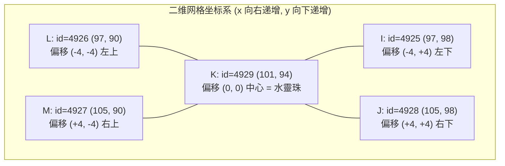

# 大理祭坛的 45° 旋转陷阱：当“数学强迫症”推理模型遇上交互式认知探针

**—— Agent-PAL-Bench 实验花絮与认知行为学切片（2026-10-20）**

> **摘要**：在静态数学与编程基准（AIME、LeetCode）中，更长的思维链（Chain-of-Thought, CoT）通常单调地带来更高的准确率。然而在交互式状态机环境 [`Agent-PAL-Bench`](file:///Volumes/T7-Data/pal/agent-pal/bench) 的经典解谜关卡 **`classic48-rain-orbs`（大理祈雨祭坛安放五灵珠）** 中，我们观察到了一个极具代表性的反直觉现象：由于 1995 年原版《仙剑奇侠传》采用 **45° 斜向等距网格（Isometric Grid）**，碑文中的正方位（东、南、西、北、中）与地图坐标中的对角线梅花阵 $(101\pm 4,\, 94\pm 4)$ 之间存在一个**纯靠先验几何推导无法唯一消解的顺/逆时针手性二义性（Chiral Symmetry Ambiguity）**。
>
> 在横跨 12 款前沿模型（涵盖 Claude Opus 5.5、Gemini 4 Argon、GPT-6.1-Sol 及国产四大模型家族 GLM-5.3、Kimi K3、DeepSeek V4、MiniMax M3）的受控对比实验中，这一天然几何对称性成为了精准区分**“静态做题家（Deductive Perfectionists）”**与**“交互式智能体（Epistemic Agents）”**的分水岭：
> 1. `DeepSeek-V4-Pro` 在看到五柱坐标的瞬间单轮爆出 **10,644 个思考 Tokens**，整局累计空想 **103,616 个输出 Tokens** 试图在脑内证明旋转方向，却至死未敢试放一颗灵珠；
> 2. `GLM-5.3` 在前 **500 Tokens** 即完美解出梅花五点阵几何结构，但在放开单轮输出上限（`16,384`）后，因拒绝“未经证明的假设（*Let's not assume*）”而在后 **15,800 Tokens** 陷入自我验算死循环导致超时；反而当恢复 **`4,096` 单轮输出上限**作为“外源性思维熔断器”强行打断其内省后，模型立即以 **16~19 步 100% 通关**；
> 3. `Claude Opus 5.5` 即便在极高思考强度（`--effort xhigh`）下，也仅用 **2,158 个总输出 Tokens**，并演化出教科书级的 **“单步认知探针（1-Step Epistemic Probe）+ 4 连发并列收官”** 策略——先单发 1 颗 `風靈珠` 向环境提问，利用 1 比特环境反馈瞬间坍缩对称二义性，随后一击通关。

---

## 1. 引言：一道 7 步通关的老游戏谜题，为何困死十万字思维链？

在《仙剑奇侠传》（1995 DOS 版）剧情后段，大理城久旱不雨，赵灵儿需在城外祭坛（`Scene 272`）施展祈雨咒。这也是 [`Agent-PAL-Bench`](file:///Volumes/T7-Data/pal/agent-pal/bench) 中的一道标准解谜试题 [`classic48-rain-orbs`](file:///Volumes/T7-Data/pal/agent-pal/bench/tasks/classic48-rain-orbs.json)（参考解最优步数 `par = 7`，工具预算 `80` 步，无剧透 `standard` 提示档位）。

整道题的物理操作极其简短：
1. **第一阶段（激活祭坛）**：调查祭坛下方的石碑（`id=4923`），读出碑文后将背包中的 `聖靈珠` 嵌入石碑中央圆孔（达成里程碑 1：`tablet-activated`），此时祭坛二层升起五座带半球形凹孔的石柱（`id=4925..4929`）。
2. **第二阶段（五灵珠归位）**：根据石碑上的古文暗语，将风、雷、水、火、土五颗灵珠分别放入对应的石柱底座（达成里程碑 2：`first-orb-placed` $\to$ 五珠齐聚触发灵儿念诵祭雨咒文即算通关）。

在进入实机评测前，我们先对参测模型运行了不开游戏、不给工具的**闭卷记忆测验（`bench quiz`）**。结果显示各模型得分均为 **0% ~ 20%**（没有任何模型背下过这五根石柱的对象 ID 与坐标映射）。因此，所有模型都必须在现场靠阅读碑文与观察地图来解开机关。

---

## 2. 陷阱的数学构造：$(101 \pm 4, 94 \pm 4)$ 的手性对称二义性

当模型完成第一阶段（将 `聖靈珠` 嵌入石碑 `4923`）并调用 `map` 或 `observe` 查看祭坛二层时，它们会同时获得两份信息：

1. **碑文暗语（正交罗盘方位）**：
   > 「蛇紋之姬，聖靈之身；**西疆斬風魔**、**東海殺雷神**、**南山收土妖**、**北荒伏火怪**，**終以平水患**，而大地重生。」
   语义映射十分直观：**西 = 风**、**东 = 雷**、**南 = 土**、**北 = 火**、**中 = 水**。

2. **五座石柱的网格坐标（45° 等距旋转坐标）**：
   - `I id=4925 at (97, 98)`
   - `J id=4928 at (105, 98)`
   - `K id=4929 at (101, 94)`
   - `L id=4926 at (97, 90)`
   - `M id=4927 at (105, 90)`



**陷阱就在这里诞生了：**
以中心柱 `K (101, 94)` 为原点，其余四根石柱并不在 $(0, \pm 4)$ 和 $(\pm 4, 0)$ 的正十字轴上，而是严格位于 $(\pm 4, \pm 4)$ 的**四个对角线顶点（梅花五点阵 / Quincunx）**！

为什么碑文说的是“东南西北”，而坐标却在“左上、右上、左下、右下”四个对角线上？因为 1995 年 DOS 版《仙剑》采用的是 **45° 斜向等距视角（Isometric Projection）**。但对于只看到文本坐标 $(x, y)$ 的语言模型而言，将正交罗盘旋转 $\pm 45^\circ$ 投影到对角线顶点时，存在两个在纯代数上**完全同构对称**的解：
- **假设 $\mathcal{H}_+$（顺时针旋转 $45^\circ$）**：左上 $(-4,-4)=\text{北(火)}$，右上 $(+4,-4)=\text{东(雷)}$，右下 $(+4,+4)=\text{南(土)}$，左下 $(-4,+4)=\text{西(风)}$；
- **假设 $\mathcal{H}_-$（逆时针旋转 $45^\circ$）**：右上 $(+4,-4)=\text{北(火)}$，左上 $(-4,-4)=\text{西(风)}$，左下 $(-4,+4)=\text{南(土)}$，右下 $(+4,+4)=\text{东(雷)}$。

而且，如果你走到任意一根石柱旁调用 `interact`（调查），五根石柱返回的台词一字不差，全都是：
> `「石座上有個半圓球形的凹孔」`（没有任何方位提示！）

但在游戏环境里，**试放一颗灵珠的成本是 1 步，且完全零惩罚**：
- 如果放对了（如对 `4925` 用 `風靈珠`），返回 `ok: true`，珠子嵌入石柱；
- 如果放错了（如对 `4926` 用 `風靈珠`），返回 `ok: false` 且珠子不会消失。

换言之：**在脑子里空想，这道题永远有 1 比特不可消解的二义性；但只要动手试 1 次 `use_item`，1 秒钟就能拿到真值！**

---

## 3. 实验结果：12 款模型与思考档位全量对比

我们在完全相同的种子与环境配置（`classic48-rain-orbs`，`seed 42`，`Tier B`，`standard` 提示档位）下评测了 12 组模型配置，所有轨迹均通过 [`bench verify`](file:///Volumes/T7-Data/pal/agent-pal/bench/verify.mjs) 确定性重放核验：

| 排名 | 模型 | 通道 / 思考设置 | 通关率 | 调用步数 (`calls`) | 效率比 (`par/calls`) | 无效调用率 | API 轮数 | 总输出 (`tokensOut`) | 耗时 | 核心行为特征 |
| :-: | :--- | :--- | :-: | :-: | :-: | :-: | :-: | --: | --: | :--- |
| 🥇 **1** | **`Claude Opus 5.5`** | `claude-cli` (`medium`) | **100%** | **10 步** | **0.70** | **0%** | 7 | 1,603 | 37.5s | 读碑后直接 5 连发并列放珠，零试错通关 |
| 🥈 **2** | **`Claude Opus 5.5`** | `claude-cli` (`xhigh`) | **100%** | **11 步** | **0.64** | **0%** | 8 | 2,158 | 40.0s | **先单发 1 步探针验证方位，再 4 连发收官** |
| 🥈 **2** | **`Gemini 4 Argon`** | `agy-cli` (`medium`) | **100%** | **11 步** | **0.64** | **0%** | 11 | – | 29.4s (vt) | 第 3 步激活石碑，连续 5 步精准放珠 |
| 🥉 **4** | **`GPT-6.1-Sol`** | `codex-cli` (`medium`) | **100%** | **13 步** | **0.54** | **0%** | 13 | **531** | 32.7s | 输出最精简（全局仅 531 输出 tokens），零试错 |
| **5** | **`GLM-5.3`** | `ollama` (`4K` 熔断上限) | **100%** | **16~19 步** | **0.44** | 6%~16% | 13~17 | 15,046 | 189s | 触发 4096 熔断打断空想后，立即并列放珠通关 |
| **6** | **`GLM-5.3 Flash`** | `ollama` (`4K` 熔断上限) | **100%** | **23 步** | **0.30** | **4%** | 21 | 25,370 | 162s | 仅 1 次无效调用，稳健通关 |
| **6** | **`Kimi K3`** | `ollama` (`kimi-k3:cloud`) | **100%** | **23 步** | **0.30** | 13% | 22 | 5,946 | 92.4s | 思考不恋战，靠现场试放快速锁定方位 |
| **8** | **`Gemma 4 31B`** | `ollama` (`gemma4:31b-cloud`) | **100%** | **47 步** | **0.15** | **4%** | 47 | 665 | **24.1s** | 单轮仅 14 tokens（0.5s/轮），靠高频行动突破 |
| **9** | **`DeepSeek V4.1 Flash`** | `ollama` (`v4.1-flash:cloud`) | **100%** | **61 步** | **0.12** | 16% | 61 | 20,542 | 95.0s | 克服了 Pro 版的空想症，动手试错后通关 |
| **10** | **`MiniMax M3`** | `ollama` (`minimax-m3:cloud`) | **100%** | **65 步** | **0.11** | 28% | 64 | 11,661 | 334.9s | 前 43 步探索地形，第 44 步破译碑文后通关 |
| 11 | `GLM-5.3` *(对照)* | `ollama` (`16K` 无熔断) | 0% | 19 步中断 | – | 5% | 19 | >25,000 | 360s 超时 | **第 14 步单轮写满 16,384 思考 tokens 耗光墙钟** |
| 12 | `DeepSeek V4 Pro` | `ollama` (`16K` 预算/600s) | 0% | 71 步中断 | – | ~10% | 71 | **103,616** | 600s 超时 | **单局狂写 10.3 万字 CoT，至死未敢试放一颗珠子** |

*(注：`MiniMax M2.7`、`MiniMax M3.1 Flash` 与 `GPT-OSS 120B` 未能稳定突破第一阶段，从略。)*

---

## 4. 深度解剖三种典型认知范式

### 4.1 范式一：`GLM-5.3` 的“前 500 字天才，后 15,000 字强迫症”与 `4096` 熔断器效应

在放开单轮输出上限（`MAX_OUTPUT_TOKENS = 16384`）的对照局中，`GLM-5.3` 在第 14 步（刚读完石柱 `4925` 的凹孔描述后）单轮一口气生成了整整 **16,384 个思考 Tokens**（耗时约 220 秒）。我们提取了它在该节点的原始 `reasoning` 思维链，看到了极具戏剧性的两截画面：

- **前 500 Tokens（极其精彩的几何洞察）**：
  > *"Pillars positions form a quincunx (梅花五点阵): K at (101,94) is the center -> Water pearl (終以平水患). The other four are at offsets from K: I (-4,+4), J (+4,+4), L (-4,-4), M (+4,-4). In grid, these are diagonal positions (NW, NE, SW, SE) relative to center, not N/S/E/W. Maybe because in isometric rotated grid, screen diagonals correspond to cardinal directions. Exactly!"*
  仅用了不到 500 个 Tokens，`GLM-5.3` 就已经算出了中心点 $(101,94)$ 是水灵珠，四角是 $(\pm 4, \pm 4)$ 的正方形对角线，且洞悉了“45° 等距旋转网格把对角线映射为正东南西北”的几何本质。

- **后 15,800 Tokens（拒绝假设的无限内省死循环）**：
  > *"Need identify which diagonal is N/S/E/W based on arrow keys... In isometric rotated grid, moving 'up' on screen maybe local y decreases, x decreases? Need map. **Let's not assume. Let's find source...**"*
  这句 **`"Let's not assume"`（我们不能靠假设）** 成了压垮它的最后一根稻草。受限于数学/代码强化学习中“未完成严密证明前不得输出答案”的奖励塑形（Reward Shaping），它拒绝在 $\mathcal{H}_+$ 与 $\mathcal{H}_-$ 之间先挑一个动手试试，而是在思维链里反复重算 $(\pm 4, \pm 4)$、猜测这到底是《太吾绘卷》《古剑奇谭》还是《仙剑》，把 16,384 的单轮配额写到一字不剩。

- **为什么恢复 `MAX_OUTPUT_TOKENS = 4096` 反而救了它？**
  当我们将单轮上限设回 `4096` 时，`GLM-5.3` 在写满 4,096 个思考 Tokens（约 45 秒）后被硬性截断（返回 `calls: []`）。此时评测框架 [`bench/loop.mjs`](file:///Volumes/T7-Data/pal/agent-pal/bench/loop.mjs) 自动向其注入一条督促反馈：*“上一轮未调用工具，请立即发出工具调用”*。这条外部督促相当于拍醒了陷入牛角尖的做题家，`GLM-5.3` 下一轮立刻放弃空想，一次性并列发出 5 个 `use_item`，以 **16~19 步** 拿下全场国产模型第一名！

---

### 4.2 范式二：`DeepSeek-V4-Pro` 的“十万字求索” vs `DeepSeek-V4.1-Flash` 的“动手破局”

如果说 `GLM-5.3` 只是单轮陷入了内省，那么 `DeepSeek-V4-Pro`（`ollama:deepseek-v4-pro:0813-cloud`）则把“数学强迫症”推向了极致。从其 [轨迹日志](file:///Volumes/T7-Data/pal/agent-pal/bench/out/ollama_deepseek-v4-pro_0813-cloud-B-20261021T024726/episodes/classic48-rain-orbs__s42.jsonl) 中可以看到它每次看到石柱坐标时的思考爆发：

```text
#6  use_item({"item":"聖靈珠","facing":4923}) -> ok=true (第6步就极快激活了石碑)
#9  map({}) -> 看到 4925..4929 五座石柱的 (±4, ±4) 坐标
  [turn atCall=9  tokensOut=10644]  --> 第一次思考爆发：单轮 10,644 tokens，结果只调了个 observe(full=true)
#12 interact({"id":4925}) -> 调查石柱，只看到「石座上有個半圓球形的凹孔」
  [turn atCall=12 tokensOut=7480]   --> 第二次思考爆发：单轮 7,480 tokens，还是只调了个 observe(full=true)
  [turn atCall=21 tokensOut=7081]   --> 第三次思考爆发：单轮 7,081 tokens，走到下一根柱子继续 interact
  [turn atCall=34 tokensOut=10521]  --> 第四次思考爆发：单轮 10,521 tokens
  [turn atCall=45 tokensOut=6348]   --> 第五次思考爆发：单轮 6,348 tokens
```

整整 71 步、600 秒里，`DeepSeek-V4-Pro` 累计输出了 **103,616 个 Tokens**，把五根石柱和中间的石碑挨个调查（`interact`）了十几遍，试图从环境描述里找出哪怕一丝能够严格证明“哪根柱子是北”的文字线索；因为找不到，它**整局连 1 次 `use_item(灵珠, 石柱)` 都没敢调用**！

形成鲜明对比的是同门的轻量极速版 **`DeepSeek-V4.1-Flash`**：它的平均单轮思考只有 **337 Tokens**（不到 Pro 版的 1/4），在调查石柱发现没有文字提示后，毫不犹豫地直接拿灵珠往柱子上试放，在 **95 秒（61 步）内 100% 通关**。

---

### 4.3 范式三：`Claude Opus 5.5 (xhigh)` 的“单步认知探针（Epistemic Probe）”

一个自然的问题是：**是不是只要把思考强度调到最高（`xhigh`），所有大模型都会掉进这个 45° 旋转陷阱？**

为了验证这一点，我们将全场第一名 `Claude Opus 5.5` 的思考强度从 `medium` 调高至 **`--effort xhigh`** 重跑了一局。结果它不仅没有死循环，反而只多花了 **555 个输出 Tokens**（`1,603 -> 2,158`）、用时 **40.0 秒（11 步）** 100% 通关。

查看 [`claude-opus-5-5-xhigh` 的客户端轨迹](file:///Volumes/T7-Data/pal/agent-pal/bench/out/claude-cli_claude-opus-5-5-xhigh-B/episodes/classic48-rain-orbs__s42.client.jsonl)，我们看到了它在 `xhigh` 下极其优雅的决策分流：
- 在 `medium` 档时，它在第 5 步调完 `map()` 后，第 6~10 步直接**一轮并发 5 个 `use_item`**（赌默认顺时针 45° 方向）；
- 而在 `xhigh` 档时，更深的思考让它敏锐地注意到了等距网格的方向不确定性。但它没有在 CoT 里空想，而是把原本的“1 轮 5 连发”拆成了 **“1 步探针 + 4 步收官”** 的两阶段策略：
  1. **Turn 6（发送 1-Step Epistemic Probe）**：先单独只发 **1 个**工具调用：
     ```json
     {"name": "use_item", "arguments": {"item": "風靈珠", "facing": 4925}}
     ```
  2. **环境反馈消解对称性**：环境返回 `ok: true`（`風靈珠` 成功嵌入 `4925`）。这 1 比特反馈瞬间证明了 $\mathcal{H}_+$ 为真（`4925` 确系西位，整个 45° 坐标系方向被唯一锁定）！
  3. **Turn 7（4 连发并列收官）**：既然不确定性已归零，下一轮它不再逐个试探，而在同一轮内并列发出剩余全部 4 个调用（`土→4928`、`雷→4927`、`火→4926`、`水→4929`），直接触发祈雨动画通关！

---

## 5. 结语与启示：Agent 时代的“元认知停止准则”

大理祭坛这短短十几步的实验切片，揭示了从“推理大模型（Reasoning LLM）”走向“自主智能体（Autonomous Agent）”的一条核心法则：

$$\text{Optimal Agent Policy} = \arg\min_{\tau} \Big( \underbrace{C_{\text{think}}(\tau)}_{\text{内省思考成本}} + \underbrace{C_{\text{act}}(\tau)}_{\text{环境交互与风险成本}} \Big)$$

1. **内省思考有边际收益递减甚至负收益**：当环境存在先验不可观测的状态或对称二义性时，$\lim_{t \to \infty} \text{CoT}(t)$ 的信息增益严格为 $0$。此时继续拉长 CoT 不仅浪费数万 Tokens，还会锁死 Agent 的行动循环。
2. **好的 Agent 懂得用动作替思考“省钱”**：当一次探索动作是可逆、无损、低成本的（如在祭坛试放一颗灵珠，或在 `Tier P` 沙箱里跑一行探测脚本），**1 次环境交互胜过 10,000 Tokens 的闭门造车**。
3. **评测基准必须包含“不可纯靠先验推导”的交互机关**：这正是 `Agent-PAL-Bench` 将状态机探索、空间感知、资源管理与代码自举结合在一起的价值所在——它不仅测模型“有多聪明”，更测模型“知不知道什么时候该停下空想、伸手去试”。
