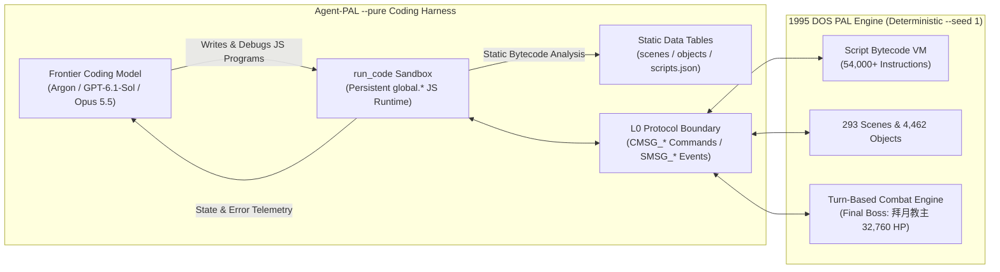

# Code, Not Controllers: How Three Frontier Coding Models Beat *Chinese Paladin* End-to-End

> **Inspired by Google DeepMind’s *"Gemini 4 Argon Beats Minecraft"* milestone** — evaluating general-purpose frontier coding models as autonomous, self-evolving software engineers inside a long-horizon game world.

---

## 1. Introduction: From *Minecraft* to *Chinese Paladin* (`Agent-PAL --pure`)

When Google DeepMind placed **Gemini 4 Argon** into a survival *Minecraft* world and watched it defeat the Ender Dragon after **27 hours and 14 minutes** of autonomous play, the breakthrough was not a custom-trained reinforcement learning policy like *AlphaGo* or *AlphaStar*. Instead, it was the **Agentic Coding Harness**: the model had no keyboard, no mouse, and no vision-action policy network. It interacted with the world exclusively by **writing, executing, and debugging thousands of short JavaScript programs** against a low-level bot API, turning gameplay into an open-ended software engineering problem.

We asked a natural follow-up question:

> **What happens when you put today’s three strongest frontier coding models—Gemini 4 Argon, GPT-6.1-Sol, and Claude Opus 5.5—into a classic 30-hour narrative CRPG with 293 scenes, non-Euclidean dungeon mazes, 54,000+ script bytecode instructions, and a 32,760-HP final boss, giving them nothing but raw protocol packets and a JavaScript `run_code` sandbox?**

In **`Agent-PAL --pure --seed 1`** mode, we stripped away all 20+ high-level game tools (`walk_to`, `fight`, `equip`, `buy`, `guide`, `plan`) and all white-box engine memory probes. Each model started at **`Scene 1` (`新的故事`, `李逍遙 Lv1`, `0`文錢)** with a single objective: **complete the entire 1995 DOS classic *Chinese Paladin* (《仙劍奇俠傳》) from start to the final ending sequence (`4342..4434`)**.

All three models succeeded **100% autonomously with zero human intervention**—and in doing so, revealed three strikingly different "software engineering personalities."

---

## 2. Headline Numbers: The "Stats of the Run"

Just as DeepMind’s *Minecraft* run was defined by `2,783` self-authored programs and `~$520` in API tokens over `27.2 hours`, here is the exact telemetry of our three frontier models conquering *Chinese Paladin* (`Scene 1 → Scene 281`) compared alongside DeepMind’s *Minecraft* benchmark:

| Metric | DeepMind Argon (*Minecraft*) | **Gemini 4 Argon** (*Agent-PAL*) | **GPT-6.1-Sol** (*Agent-PAL*) | **Claude Opus 5.5** (*Agent-PAL*) |
| :--- | :--- | :--- | :--- | :--- |
| **World & Objective** | Survival World → Defeat Ender Dragon | `Scene 1 (Lv1)` → Defeat `拜月教主` & Full Ending | `Scene 1 (Lv1)` → Defeat `拜月教主` & Full Ending | `Scene 1 (Lv1)` → Defeat `拜月教主` & Full Ending |
| **Outcome** | **100% Cleared** | **100% Cleared (`Slots 1–99`)** | **100% Cleared (`Slots 1–99`)** | **100% Cleared (`Slots 1–99`)** |
| **Session Continuity** | Multi-agent continuous | 1 conversation (`102.7 min` core run; 3 server segments total) | **1 single uninterrupted session** | 2 relay rounds (`R1: Scene 1→231`, `R2: 231→281`) |
| **Wall-Clock Duration** | `27h 14m` | **`1h 43m`** (`102.7 min` core) / `~8.9h` total | **`2h 28m`** (`147.8 min`) | **`3h 49m`** (`228.5 min`) |
| **Self-Authored JS Programs (`run_code`)** | `2,783` | `1,704` (`449` in Seg 1) | **`844`** | `1,390` |
| **Total Input Tokens** | — | **`243.31M`** (`51.09M` in Seg 1) | **`194.21M`** (`194,205,716`) | **`~720.0M`** (`~458M` R1 + `~262M` R2) |
| **Prompt Cache Hit Rate** | — | **97.26%** (`236.65M` cached) | **98.89%** (`192.06M` cached) | **~99.7%** (`~718M` cached) |
| **Uncached Input Tokens** | — | `6.66M` | **`2.15M`** (`2,147,092`) | **`~2.10M`** |
| **Total Output Tokens** | — | `1,356,000` (`218.3K` in Seg 1) | **`167,033`** (`65K` reasoning + `102K` code) | `~500,000` (`~260K` thinking + `~240K` code/text) |
| **API Token Cost (USD)** | `~$520` | — | — | **`$165.21`** (`$105.08` R1 + `$60.13` R2) |
| **Self-Coded Library Artifact** | Persistent notes + JS scripts | [`argon-pure-lib.js`](../../apps/agent-pal/src/argon-pure-lib.js) (`731` lines / `35.7 KB`) | [`gpt61-pure-lib.js`](../../apps/agent-pal/src/gpt61-pure-lib.js) (`135` lines / `115.9 KB`) | [`opus-pure-lib.js`](../../apps/agent-pal/src/opus-pure-lib.js) (`1,427` lines / `217.7 KB`) |
| **Final Party Levels (`Slot 99`)** | — | `李 Lv43 / 靈 Lv37 / 奴 Lv42` | `李 Lv46 / 靈 Lv41 / 奴 Lv45` | `李 Lv54 / 靈 Lv50 / 奴 Lv52` |

---

## 3. Why *Chinese Paladin* Is a Brutal Stress Test for Coding Agents

In *Minecraft*, the physics rules are uniform everywhere: blocks are 1×1×1 cubes in a 3D Euclidean grid. In a 1995 DOS RPG like *Chinese Paladin*, **the world’s physics are hidden inside 54,000+ instructions of proprietary 16-bit event bytecode**:

1. **Non-Euclidean Dungeon Topologies**:
   - **Xianling Island (`Scene 8`)**: Floating lotus pads (`0x0070` / `0x0044`) teleport the player across water barriers only after 6 Asura statues are smashed with `破天鎚`.
   - **Demon Lock Tower (`Scene 185` & `Scene 156`)**: 9 isolated stone islands linked by 66 bidirectional moving iron chains (`0x0070`/`0x007A`), plus floor switches that mutate distant copper doors via `0x0024` / `0x0049`.
   - **God Wood Forest (`Scene 192`)**: 15 canopy islands connected by 54 one-way vine-swing scripts (`0x0044`), guarded by monkeys that only move when fed `香蕉`.
   - **Trial Cave (`Scenes 203, 217–219`)**: Collapsing floor traps that shift the player by signed 16-bit relative pixel offsets (`0x006E`) into lower floors, plus wall-mounted climbable ropes (`triggerMode = 1`) sitting on impassable `#` wall tiles.
   - **Nüwa Ruins (`Scenes 221–226`)**: 42 five-deity teleporter pads implemented not as normal warps, but as **same-scene `0x0059` (ChangeScene) + `0x0046` (SetPosition)** scripts across 24 disconnected chambers.
2. **Causal Story Locks Across 293 Scenes**:
   - Raising a drawbridge, opening a tomb (`將軍塚` requiring `玉佛珠` equipped), surviving scripted unwinnable battles (`石長老`, `林天南`), or collecting **36 `傀儡蟲`** requires tracing bytecode cross-references across thousands of script addresses.
3. **High-Stakes Multi-Actor Tactical Combat**:
   - The final boss **`拜月教主` (`32,760 HP`)** attacks twice per round with party-wide AoE spells (`水魔獸` / `奪魂` / `風捲殘雲`) and summons adds. A naive attack loop wipes within 3 rounds.

---

## 4. Three Models, Three Software Engineering Personalities

Given the exact same `--pure --seed 1` harness, no two models wrote the same software architecture. Each model’s self-authored runtime library ([`argon-pure-lib.js`](../../apps/agent-pal/src/argon-pure-lib.js), [`gpt61-pure-lib.js`](../../apps/agent-pal/src/gpt61-pure-lib.js), [`opus-pure-lib.js`](../../apps/agent-pal/src/opus-pure-lib.js)) reflects a distinct engineering philosophy.

### 4.1 Gemini 4 Argon: The Systems Pragmatist & Tactical Speedrunner

- **Engineering Philosophy**: **Closed-Loop Reactive State Machines**.
  Rather than building a massive offline compiler upfront, Argon engineered a rock-solid runtime control loop ([`argon-pure-lib.js`](../../apps/agent-pal/src/argon-pure-lib.js), `731` well-structured lines):
  - `global.goTo(x, y, opts)`: Wraps L0 navigation in a 40-step closed-loop recovery automaton. Whenever a random battle, story cutscene, or wandering `triggerMode >= 5` monster interrupts movement, `goTo` automatically fights the battle, drains the dialog, clears the blocker, and resumes pathfinding without returning control to the LLM.
  - `global.equip(itemName, member)`: Drives the raw L0 in-game menu state machine (`CMSG_KEY("Menu")` $\to$ `CMSG_CHOICE` cursor selection) without touching internal engine memory.
- **Signature Gameplay Moment — Beating `拜月教主` (`32,760 HP`) at Just `Lv43`**:
  Argon achieved the fastest, lowest-level victory of all three models (**11 rounds, 0 deaths** at `李逍遙 Lv43 / 趙靈兒 Lv37 / 阿奴 Lv42`):
  - **Round 1**: `李逍遙` throws `隱蠱` (granting 3 rounds of party-wide stealth), `趙靈兒` casts `武神`, `阿奴` opens with `乾坤一擲`.
  - **Rounds 2–4**: Under stealth cover, `李逍遙` casts `真元護體` (`50%` physical & magic damage reduction for 8 rounds) on all three party members.
  - **Rounds 5–7**: `李逍遙` unleashes `酒神` #1 (`-4,837 HP`), `趙靈兒` feeds `雪蓮子` (`+400 MP`) to `李逍遙`, and `李逍遙` chains `酒神` #2 (`-3,572 HP`), melting the boss down to `7,225 HP` before finishing with `雙龍劍` throw + `乾坤一擲`.

---

### 4.2 Claude Opus 5.5: The Compiler Architect & Industrial Grinder

- **Engineering Philosophy**: **Static Bytecode-to-Graph Compilation & Automated Farming**.
  Opus 5.5 treated the 1995 RPG data tables as a compiler target, writing `76` functions across `1,427` lines ([`opus-pure-lib.js`](../../apps/agent-pal/src/opus-pure-lib.js)):
  - **Reverse-Engineering Disassembler (`dis`, `sum`, `whoSets`, `whoRuns`, `chainBack`)**: Built a static call-graph tracer that answers *"Which floor switch in Scene 156 opens Copper Door #2619?"* in a single query.
  - **Unified Hybrid Graph BFS (`teleLinks`, `relJumps`, `path2`)**: Compiled `0x0070` moving platforms, `0x0044` vine rides, and `0x006E` signed 16-bit collapsing floor traps directly from bytecode into directed graph edges, reducing a 109-step Demon Lock Tower detour (`Scene 185`) to a 3-step `['left', 'T3203', 'left']` hop.
  - **Connected-Component Region Planner (`compsOf`, `regionGraph`)**: Partitioned every scene into walkable islands (`scene:compId`) and solved multi-floor dungeon transfers via BFS.
- **Signature Gameplay Moment — Industrialized Farming & Economic Overwhelm**:
  - For the `36隻傀儡蟲` quest, Opus wrote an autonomous connected-component farming bot (`farmTour` + `farmAct2`) that patrolled `試煉窟` (`Scenes 217–219`), casting `飛龍探雲手` to steal bugs before killing monsters until `bagQty('傀儡蟲') === 36`.
  - Before the final boss, Opus wrote an automated dungeon grinding loop in `Scenes 285/287` to level the party to **`Lv54 / Lv52 / Lv50`** and amass **`$118,565` in cash**—then buried `拜月教主` under **12 consecutive `乾坤一擲` cash-throws** (`$64,006` spent) and a final `酒神` strike.

---

### 4.3 GPT-6.1-Sol: The Ultra-Dense Functional Theorist & One-Shot Marathoner

- **Engineering Philosophy**: **Zero-Ceremony Functional Code Generation & Exact Topological Modeling**.
  GPT-6.1-Sol is the only model to clear the entire game from `Scene 1` to `Scene 281` in **one single uninterrupted session (`2h 28m`, `845` tool calls)** while generating only **`167,033` output tokens** (`102,000` code/text tokens—3× to 8× fewer than the other models!).
  - **Ultra-Compact One-Liner Library (`135` lines, [`gpt61-pure-lib.js`](../../apps/agent-pal/src/gpt61-pure-lib.js))**: Every helper (`global.flood`, `global.exits`, `global.dungeonRoute`, `global.positionRoute`, `global.fight`) was written as a dense functional one-liner, minimizing token generation latency.
  - **Solving the Two Topological Blind Spots that Stumped Other Compilers**:
    1. **Wall-Mounted Search Portals (`triggerMode 1..3`)**: In `試煉窟` and `女媧遺跡` (`Scenes 217–223`), 11 key ropes and secret doors sit on impassable `#` wall tiles and require pressing `Search` (`Space`) from a distance of 1–2 tiles. GPT-6.1-Sol assigned `reachRadius = 2` to `triggerMode 1..3` exits, unlocking the entire Nüwa Ruins graph.
    2. **Same-Scene `0x0059` Teleporter Mazes**: In `Scenes 221, 223, 225, 226`, 42 teleporter pads use `0x0059` (ChangeScene) targeting the *same* scene ID plus `0x0046` (SetPosition). By preserving `targetScene === currentScene` transitions as intra-scene edges, GPT-6.1-Sol swept all **36 `傀儡蟲` and Nüwa Ruins in just 9 minutes** (`15:05Z–15:15Z`).
  - **Data-Driven Elemental Resistance Combat (`global.fight`)**: Read `enemy.physicalResistance` and `enemy.elemResistance[0..4]` directly from `global.data.objects` to rank spells by expected damage per MP, automatically switching `李逍遙` to `天罡戰氣 + 醉仙望月步` double-crit physical combos whenever `physicalResistance < 8`.

---

## 5. Convergent Evolution: When Two AI Models Independently Invent a Bytecode Compiler

One of the most fascinating findings of this experiment is **convergent algorithmic evolution**. Neither Claude Opus 5.5 nor GPT-6.1-Sol was told how *Chinese Paladin* encodes map transitions, moving platforms, or dungeon floors. Yet when confronted with multi-island dungeons, both models independently converged on the exact same four-stage compiler pipeline:

1. **Isometric Block-to-Grid Coordinate Inversion**:
   Both derived the exact inverse transform from PAL’s `(bx, by, h)` block coordinates in `0x0046`/`0x0070`/`0x0044` operands to `(gx, gy)` pathfinding grid coordinates:
   $$gx = bx + by + h, \qquad gy = by - bx + 64$$
2. **Walkable Island Decomposition (Connected Components)**:
   Both flood-filled each scene’s `192×192` tile grid (`rows[y][x] === '.'`) while **masking out non-target portal trigger radii** so the agent never accidentally steps onto an unintended exit while crossing a room.
3. **Bytecode-to-Edge Extraction**:
   Both scanned `scripts.json` to turn opcodes (`0x0059`, `0x0046`, `0x0070`, `0x007A`, `0x007B`, `0x0044`, `0x006E`) into directed graph edges between `(scene, component)` nodes.
4. **Two-Level Hierarchical BFS**:
   Both separated **macro-routing** (BFS across `(scene, island)` nodes) from **micro-stepping** (hybrid grid + teleport BFS within a single scene).

By fusing Opus 5.5’s generalized intra-scene hybrid BFS (`path2` + `006E` signed relative offset pads + causal switch tracer `whoMutatesObject`) with GPT-6.1-Sol’s wall-mounted `search: true` portal radius (`exitReachRadius`) and same-scene `0059` teleporter compiler into our standalone module [`bytecode-compiler.mjs`](../../apps/agent-pal/src/bytecode-compiler.mjs), the combined planner automatically routes **16 hops from the Trial Cave entrance (`216:1`) to the deepest Nüwa Five-Deity Chamber (`226:1`)** across 11 scenes, 3 wall-mounted secret doors, and 3 same-scene `0059` teleporter mazes in **under 50 milliseconds** ([`bytecode-compiler-demo.mjs`](../../apps/agent-pal/src/bytecode-compiler-demo.mjs)).

---

## 6. Key Takeaways for Agentic Coding & Long-Horizon AI

1. **Code Is the Universal Action Space**:
   Just as DeepMind’s Argon agents used Mineflayer JS scripts to bridge raw *Minecraft* ticks and high-level survival goals, all three models in `Agent-PAL --pure` proved that **a Turing-complete `run_code` sandbox + L0 protocol telemetry is strictly more powerful than a fixed menu of 20+ hand-crafted MCP tools**. When an pre-built tool fails on an edge case (like a monkey blocking a vine in `Scene 192` or a 1-turn prompt revision lag in battle), a tool-only agent gets stuck; a self-coding agent inspects the state, patches its own library, and moves on.
2. **Prompt Caching Makes 200M–720M Token Epics Economically Viable**:
   Completing a 30-hour RPG required `845` to `1,738` turns and `194M` to `720M` total input tokens—yet achieved **97.26% to 99.7% prompt cache hit rates** across all three model families, keeping uncached input tokens down to just `2.1M–6.6M` (`$165.21` total API cost for Opus 5.5’s 3.8-hour run).
3. **Different Models Excel at Different Layers of the Stack**:
   - **Gemini 4 Argon** excelled at **reactive systems control and tactical combat efficiency** (lowest-level boss kill, zero-death stealth/shield orchestration).
   - **Claude Opus 5.5** excelled at **modular software architecture, static analysis tooling, and relentless resource grinding**.
   - **GPT-6.1-Sol** excelled at **token-optimal functional synthesis, edge-case topological completeness, and single-session marathon stability**.

---

## 7. Artifacts & Reproducibility

All code, playthrough reports, unit tests, and runnable demos are committed in the repository:

- **Individual Playthrough Reports**:
  - Gemini 4 Argon: [`docs/specs/argon-pure-playthrough-report.md`](../specs/argon-pure-playthrough-report.md)
  - Claude Opus 5.5: [`docs/specs/opus-pure-playthrough-report.md`](../specs/opus-pure-playthrough-report.md)
  - GPT-6.1-Sol: [`docs/specs/gpt61-pure-playthrough-report.md`](../specs/gpt61-pure-playthrough-report.md)
- **Self-Authored Model Libraries**:
  - Gemini 4 Argon (`731` lines): [`apps/agent-pal/src/argon-pure-lib.js`](../../apps/agent-pal/src/argon-pure-lib.js)
  - Claude Opus 5.5 (`1,427` lines): [`apps/agent-pal/src/opus-pure-lib.js`](../../apps/agent-pal/src/opus-pure-lib.js)
  - GPT-6.1-Sol (`135` lines): [`apps/agent-pal/src/gpt61-pure-lib.js`](../../apps/agent-pal/src/gpt61-pure-lib.js)
- **Unified Standalone Bytecode Compiler & Topology Planner**:
  - Module: [`apps/agent-pal/src/bytecode-compiler.mjs`](../../apps/agent-pal/src/bytecode-compiler.mjs)
  - Demo (`Scenes 192, 185, 203, 156, 216–226`): [`apps/agent-pal/src/bytecode-compiler-demo.mjs`](../../apps/agent-pal/src/bytecode-compiler-demo.mjs)
  - Unit Tests (`8/8` passing): [`apps/agent-pal/test/bytecode-compiler.test.mjs`](../../apps/agent-pal/test/bytecode-compiler.test.mjs)
- **Agent-PAL-Bench Paper Drafts**:
  - Chinese Draft: [`docs/papers/agent-pal-bench-draft.md`](./agent-pal-bench-draft.md)
  - English Draft: [`docs/papers/agent-pal-bench-draft.en.md`](./agent-pal-bench-draft.en.md)
  - LaTeX Paper: [`docs/papers/agent-pal-bench-draft.tex`](./agent-pal-bench-draft.tex)
