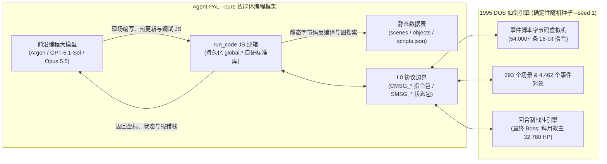

# 代码而非手柄：三大前沿编程模型如何全自主通关《仙剑奇侠传》

> **致敬 Google DeepMind《Gemini 4 Argon 通关 Minecraft》里程碑实验** —— 将通用前沿编程大模型置于零预置外挂的 **Agentic Coding Harness（智能体编程框架）** 中，看它们如何通过现场手写、调试与演进 JavaScript 代码库，从零打穿一款 30 小时流程的经典叙事与迷宫 RPG。

---

## 1. 引言：从《Minecraft》末影龙到《仙剑奇侠传》拜月教主

在 Google DeepMind 发布的里程碑研究（Maxence Faldor、Satinder Singh、Roberta Raileanu）中，**Gemini 4 Argon** 在随机生成的《Minecraft》生存世界里连续奋战 **27 小时 14 分钟**，最终击败末影龙通关。那场实验最震撼业界的地方在于：它没有使用像 *AlphaGo* 或 *AlphaStar* 那样针对单一游戏专门训练的强化学习（RL）策略网络，也没有用视觉模型去模拟鼠标和键盘按键；相反，DeepMind 构建了一个 **Agentic Coding Harness（“Code, Not Keyboards”）**——智能体只能通过现场编写、执行和调试数以千计的 JavaScript 短程序（基于 Mineflayer 协议接口）来感知世界、采集资源、三角定位要塞并与末影龙战斗。

受这一范式启发，我们在 **Agent-PAL** 上提出了一个更具“软件工程与逆向分析”挑战性的问题：

> **如果把当今最顶尖的三大前沿编程模型——Gemini 4 Argon、GPT-6.1-Sol 与 Claude Opus 5.5——放进 1995 年 DOS 经典原版《仙剑奇侠传》中，剥夺所有预置的高阶辅助工具（`--pure --seed 1` 模式），只提供底层网络协议收发（`CMSG_*` / `SMSG_*`）、静态数据表与一个 `run_code` JavaScript 沙箱，它们能否从“新的故事（李逍遥 Lv1）”一路全自主写代码打通大结局？**

答案是：**三个模型全部在零人工干预下实现了 100% 端到端通关（`Scene 1` 余杭客栈 $\to$ `Scene 281` 击败 `32,760 HP` 拜月教主并播放完整结局 `4342..4434`）**。更令人着迷的是，面对完全相同的底层协议边界，三个模型自发演化出了截然不同的**“软件工程人格”**与**“通关流派”**。

---

## 2. 核心战报总览（The Stats of the Run）

对标 DeepMind Argon 在《Minecraft》中“27 小时 14 分钟、手写 2,783 个 JS 程序、消耗约 `$520` API Token”的经典战报卡，下表汇总了三大模型在 **`Agent-PAL --pure --seed 1`** 下的完整遥测数据：

| 评测维度 | DeepMind Argon (*Minecraft*) | **Gemini 4 Argon** (*Agent-PAL*) | **GPT-6.1-Sol** (*Agent-PAL*) | **Claude Opus 5.5** (*Agent-PAL*) |
| :--- | :--- | :--- | :--- | :--- |
| **任务目标** | 随机生存世界 $\to$ 击败末影龙 | `Scene 1 (Lv1)` $\to$ 击败拜月教主 & 完整结局 | `Scene 1 (Lv1)` $\to$ 击败拜月教主 & 完整结局 | `Scene 1 (Lv1)` $\to$ 击败拜月教主 & 完整结局 |
| **最终完成度** | **100% 通关** | **100% 通关（存档 `Slots 1–99`）** | **100% 通关（存档 `Slots 1–99`）** | **100% 通关（存档 `Slots 1–99`）** |
| **会话连续性** | 多智能体连续运行 | 1 次完整对话（主线通关 `102.7 min`；含复盘共 3 段） | **单次会话一镜到底（1 Round 零中断）** | 2 轮接力（`R1: Scene 1→231`，`R2: 231→281`） |
| **挂钟总耗时** | `27 小时 14 分` | **`1 小时 43 分`**（主线段）/ `~8.9 小时`（全 3 段） | **`2 小时 28 分`**（`147.8 min`） | **`3 小时 49 分`**（`228.5 min`） |
| **自编写执行 JS 程序数 (`run_code`)** | `2,783` 次 | `1,704` 次（主线段 `449` 次） | **`844` 次** | `1,390` 次 |
| **累计输入 Token 总量** | — | **`243.31M`**（主线段 `51.09M`） | **`194.21M`**（精确值 `194,205,716`） | **`~720.0M`**（`R1 ~458M` + `R2 ~262M`） |
| **Prompt 缓存命中率** | — | **97.26%**（`236.65M` 命中） | **98.89%**（`192.06M` 命中） | **~99.7%**（`~718M` 命中） |
| **未缓存净输入 Token** | — | `6.66M` | **`2.15M`**（`2,147,092`） | **`~2.10M`** |
| **累计输出 Token 总量** | — | `1,356,000`（主线段 `218.3K`） | **`167,033`**（`65K` 推理 + `102K` 代码） | `~500,000`（`~260K` 思考 + `~240K` 代码/文本） |
| **API 账单总成本 (USD)** | `~$520` | — | — | **`$165.21`**（`R1 $105.08` + `R2 $60.13`） |
| **自研运行时代码库沉淀** | 共享笔记 + 脚本集 | [`argon-pure-lib.js`](../../apps/agent-pal/src/argon-pure-lib.js)（`731` 行 / `35.7 KB`） | [`gpt61-pure-lib.js`](../../apps/agent-pal/src/gpt61-pure-lib.js)（`135` 行 / `115.9 KB`） | [`opus-pure-lib.js`](../../apps/agent-pal/src/opus-pure-lib.js)（`1,427` 行 / `217.7 KB`） |
| **通关全员等级 (`Slot 99`)** | — | `李 Lv43 / 灵 Lv37 / 奴 Lv42` | `李 Lv46 / 灵 Lv41 / 奴 Lv45` | `李 Lv54 / 灵 Lv50 / 奴 Lv52` |

---

## 3. 为什么《仙剑奇侠传》是检验编程智能体的绝佳试金石？

在《Minecraft》中，全世界的物理规则是均匀且统一的：任何地方的方块都遵循三维欧几里得网格。而在 1995 年的《仙剑奇侠传》中，**世界真正的物理拓扑与因果律全部隐藏在 54,000 多条 16 位私有脚本字节码（Bytecode）里**：

1. **非欧几里得迷宫拓扑（单纯网格 A\*/BFS 100% 死路）**：
   - **仙灵岛荷花池 (`Scene 8`)**：荷叶之间被水隔断，必须用破天锤砸碎 6 尊阿修罗石像后，踩上特定荷叶触发 `0x0070` / `0x0044` 脚印移动指令才能飞渡。
   - **锁妖塔铁索浮板层 (`Scene 185`) 与铜门机关层 (`Scene 156`)**：9 座悬空孤岛靠 66 条双向移动铁索浮板（`0x0070`/`0x007A`）连接；远处的铜门必须靠踩踏另一端的地板机关（通过 `0x0024`/`0x0049` 跨对象改写状态位）才能开启。
   - **神木林树冠 (`Scene 192`)**：15 个树冠孤岛靠 54 条单向抓藤跳跃脚本（`0x0044`）相连，且藤条入口被猴子挡死，必须用背包里的“香蕉”喂猴子才能让路。
   - **试炼窟深渊 (`Scenes 203, 217–219`)**：遍布 `0x006E` 塌陷流沙陷阱（将玩家按有符号 16 位像素偏移量甩向其他位置或坠入下层），且各层切分为十几个不连通的孤岛，爬回上层的绳索嵌在 `#` 不可通行的墙壁格上（`triggerMode = 1`，需隔墙按空格触发）。
   - **女娲遗迹五神石迷宫 (`Scenes 221–226`)**：42 座传送法阵并非普通移动指令，而是通过**“向当前同一场景发送 `0x0059`（切换场景）+ `0x0046`（设置坐标）”**实现的同场景跨孤岛瞬移。
2. **横跨 293 个场景的长程因果锁**：
   - 将军冢必须让角色**穿戴上**从智修大师处打来的“玉佛珠”才能触发墓门开启；石长老与林天南是**必败剧情战**（硬吃回合即可过关，若死磕复活反而耗尽资源）；救醒赵灵儿需要集齐 **36 只傀儡虫**。
3. **高压多角色协同回合制博弈**：
   - 最终 Boss **拜月教主（`32,760 HP`）**每回合二动，连发全屏高伤法术（水魔兽、风卷残云）与夺魂控制，还会召唤小怪。没有严密的护盾、隐身、群体回血与爆发状态机，3 回合内就会全军覆没。

---

## 4. 三大模型，三种截然不同的“软件工程人格”

在完全相同的 `--pure --seed 1` 起点上，三个模型写出了三套风格迥异的运行时标准库（[`argon-pure-lib.js`](../../apps/agent-pal/src/argon-pure-lib.js)、[`gpt61-pure-lib.js`](../../apps/agent-pal/src/gpt61-pure-lib.js)、[`opus-pure-lib.js`](../../apps/agent-pal/src/opus-pure-lib.js)）：

### 4.1 Gemini 4 Argon：系统实用主义者与极限低通速通王

- **工程哲学：闭环容错状态机（Closed-Loop Reactive Automaton）**
  Argon 没有在一开始花大量时间写复杂的离线编译器，而是构建了一套极其稳健的**运行时闭环控制流**（[`argon-pure-lib.js`](../../apps/agent-pal/src/argon-pure-lib.js)，`731` 行）：
  - `global.goTo(x, y, opts)`：将底层 `nav.walk_to` 封装进一个 40 步自恢复状态机。途中只要撞上暗雷怪、触发剧情对话、或被 `triggerMode >= 5` 的巡逻小怪挡路，`goTo` 会自动打完战斗、排空对话、清理拦路怪并继续朝 `(x, y)` 寻路，无需中断交回大模型。
  - `global.equip(itemName, member)`：纯靠发送 L0 按键包（`CMSG_KEY("Menu")` $\to$ `CMSG_CHOICE`）驱动原版多级菜单完成穿戴，完全不依赖任何白盒内存探针。
- **高光名场面：全员仅 `Lv43 / Lv37 / Lv42`、11 回合零阵亡秒杀 `32,760 HP` 拜月教主**
  Argon 创下了三模型中**最低等级、最快回合数**的最终 Boss 击杀纪录：
  - **第 1 回合**：李逍遥投掷 **`隐蛊`**（全员进入 3 回合隐身无敌窗口），赵灵儿召唤 `武神`，阿奴 `乾坤一掷` 削血。
  - **第 2–4 回合**：趁隐身未破，李逍遥依次为全队三人套满 **`真元护体`**（物理与法术承伤减半，持续 8 回合）。
  - **第 5–7 回合**：李逍遥释放第 1 发 **`酒神`**（耗尽 `579 MP`，炸掉 `4,837 HP`）$\to$ 赵灵儿立刻喂李逍遥吃 **`雪莲子`**（`+400 MP`）$\to$ 李逍遥紧接第 2 发 **`酒神`**（再炸 `3,572 HP`），接投掷 `双龙剑` 与阿奴 `乾坤一掷`，11 回合零死完美收官。

---

### 4.2 Claude Opus 5.5：编译器架构师与工业化刷怪狂魔

- **工程哲学：静态字节码图编译器 + 全自动刷钱刷材料流水线**
  Opus 5.5 把整部《仙剑》的数据表当成了编译原理课设，写出了三模型中规模最大、模块化程度最高的工程库（[`opus-pure-lib.js`](../../apps/agent-pal/src/opus-pure-lib.js)，`1,427` 行、`76` 个顶层函数）：
  - **静态反汇编与因果溯源器（`dis`, `sum`, `whoSets`, `whoRuns`, `chainBack`）**：一行调用即可逆向追踪“锁妖塔 `Scene 156` 的哪块地板机关修改了 `#2619` 铜门的碰撞状态”。
  - **单场景广义混合图寻路（`teleLinks`, `relJumps`, `path2`）**：自动从字节码中提取 `0x0070` 双向浮板、`0x0044` 乘藤跳跃与 `0x006E` 有符号 16 位流沙陷阱，将锁妖塔 `Scene 185` 原本需要绕行 109 步的路线直接压缩为 `['left', 'T3203', 'left']` 3 步飞渡。
  - **多孤岛连通分量换乘规划器（`compsOf`, `regionGraph`）**：将每个场景切分为独立步行孤岛（`scene:compId`），在跨场景+跨孤岛图上做双层 BFS。
- **高光名场面：全自动“飞龙探云手”刷虫机 & 11.8 万文钱氪金碾压流**
  - 面对“集齐 36 只傀儡虫”任务，Opus 没有去商店买，而是写了一套跨孤岛自动巡逻脚本 `farmTour` + `farmAct2`：在试炼窟（`Scenes 217–219`）循环遇敌，先用李逍遥 **`飞龙探云手`** 偷取傀儡虫再击杀怪物，全自动刷满 `36/36` 只！
  - 决战拜月教主前，Opus 在王宫地牢（`Scenes 285/287`）开启工业化挂机刷怪，把全员等级硬生生刷到 **`Lv54 / Lv52 / Lv50`**、存款刷到惊人的 **`118,565` 文钱**，然后在最终战里连砸 **12 发 `乾坤一掷`**（狂撒 `64,006` 文钱）外加一发 `酒神` 终结拜月。

---

### 4.3 GPT-6.1-Sol：极简高密函数式理论家与一镜到底马拉松选手

- **工程哲学：零废话单行函数式生成 + 最完备迷宫拓扑建模**
  GPT-6.1-Sol 是唯一一个**在单次会话中一镜到底（`2 小时 28 分`、`845` 次工具调用、零中继重启）**打穿全游戏的模型，且全程仅生成了 **`167,033` 个输出 Token**（其中代码与文本仅 `102,000` Token，不到其他模型的 1/3 甚至 1/8）：
  - **极致紧凑的单行函数式代码库（`135` 行，[`gpt61-pure-lib.js`](../../apps/agent-pal/src/gpt61-pure-lib.js)）**：所有核心规划器（`global.flood`、`global.exits`、`global.dungeonRoute`、`global.positionRoute`、`global.fight`）均以高密度单行函数增量覆写，极大压缩了每轮生成耗时。
  - **攻克另外两个模型未覆盖的两大拓扑盲区**：
    1. **嵌在 `#` 墙壁上的按空格暗门与绳索（`triggerMode 1..3`）**：试炼窟与女娲遗迹（`Scenes 217–223`）中有 11 处绳索和暗门嵌在不可通行的 `#` 墙体上，必须走到距离 1–2 格处按空格触发。GPT-6.1-Sol 为 `triggerMode 1..3` 赋予了 `reachRadius = 2` 并标记 `search: true`，一次性打通全部暗门。
    2. **同场景 `0x0059 + 0x0046` 传送阵迷宫**：女娲遗迹（`Scenes 221, 223, 225, 226`）的 42 座五神石传送阵使用的是“切换至当前同一场景 ID + 设坐标”。GPT-6.1-Sol 保留了 `toScene === currentScene` 的同场景传送边，使其**仅用 9 分钟（`15:05Z–15:15Z`）就扫空整个试炼窟 36 只傀儡虫并直穿女娲遗迹五神石迷宫**。
  - **基于抗性表期望伤害排序的战斗引擎（`global.fight`）**：直接读取 `global.data.objects` 中的 `physicalResistance` 与五灵抗性 `elemResistance[0..4]`，动态计算每点 MP 的抗性折算期望伤害；当检测到 Boss `physicalResistance < 8` 时，自动切换为李逍遥 **`天罡战气 (311)` + `醉仙望月步 (390)`** 双倍暴击平砍流。

---

## 5. 算法的趋同演化：当两个大模型独立发明“字节码拓扑编译器”

本次三模型对比实验最令人拍案叫绝的科学发现，是 **Claude Opus 5.5 与 GPT-6.1-Sol 的算法趋同演化（Convergent Evolution）**。

我们在提示词中从未提及《仙剑》的坐标换算公式、浮板指令编码或连通分量图论。然而，当面对神木林、锁妖塔和试炼窟的孤岛迷宫时，Opus 5.5 与 GPT-6.1-Sol **完全独立地发明了同一套四阶段静态字节码拓扑编译器**：

1. **斜 45 度等距块坐标（Block）到寻路网格（Grid）的逆变换**：
   两个模型都独立推导出了 `0x0046` / `0x0070` / `0x0044` 三元组操作数 `(bx, by, h)` 到网格坐标 `(gx, gy)` 的精确公式：
   $$gx = bx + by + h, \qquad gy = by - bx + 64$$
2. **带出口触发区掩码的连通分量分解（Connected-Component Flood-Fill）**：
   两个模型都在 `192×192` 地图上对 `.` 可通行格做连通分量标号，并且都意识到**必须在漫水填充时抠掉非目标传送出口的触发半径（`triggerMode - 4`）**，防止智能体在房间内赶路时误踩其他传送阵被传飞。
3. **跨指令集有向边静态提取**：
   自动扫描 `scripts.json`，将 `0x0059`（切场景）、`0x0046`（设坐标）、`0x0070`/`0x007A`/`0x007B`（浮板/瞬移）、`0x0044`（抓藤）、`0x006E`（相对位移滑坡）编译为连接不同 `(scene, island)` 节点的有向边。
4. **“宏观孤岛换乘 + 微观单场景混合寻路”双层 BFS**。

我们将 Opus 5.5 的单场景广义混合寻路（`path2` + `006E` 滑坡 + 机关因果反查 `whoMutatesObject`）与 GPT-6.1-Sol 的嵌墙暗门识别（`exitReachRadius`）及同场景 `0059` 传送阵编译器融合，提炼成了仓库中的独立公共模块 [`bytecode-compiler.mjs`](../../apps/agent-pal/src/bytecode-compiler.mjs)。在实机演示 [`bytecode-compiler-demo.mjs`](../../apps/agent-pal/src/bytecode-compiler-demo.mjs) 中，该融合编译器能在 **50 毫秒内**自动规划出从**试炼窟入口 (`216:1`) 直达女娲遗迹最深处五神石密室 (`226:1`) 的 16 段跨场景+跨孤岛+暗门+同场景法阵换乘路线**。

---

## 6. 对 Agentic Coding 与长程智能体架构的核心启示

1. **代码即终极动作空间（Code Is the Universal Action Space）**：
   正如 DeepMind 用 Mineflayer JS 脚本让 Argon 打穿《Minecraft》，三个模型在 `Agent-PAL --pure` 下的一致通关证明：**一个图灵完备的 `run_code` 沙箱 + L0 底层协议，在表达力与鲁棒性上全面超越 20 多个手工预置的高阶 MCP 工具**。面对预置工具未曾预料的边界情况（如神木林猴子挡藤条、必败战回合判定、战斗 Prompt 1 回合延迟），纯工具调用智能体会陷入死循环，而自编程智能体能现场阅读数据、打补丁升级自己的函数库并继续前进。
2. **高命中率 Prompt Caching 让亿级 Token 长程任务具备商业可行性**：
   打穿整部 30 小时 RPG 需要 `845` 至 `1,738` 轮交互、累计 `1.94 亿` 至 `7.20 亿` 输入 Token；但得益于 **97.26%–99.7% 的 Prompt 缓存命中率**，整场通关的未缓存净输入仅 `215 万–666 万` Token（Opus 5.5 历时 3.8 小时的完整通关账单仅 **`$165.21`**）。
3. **不同前沿模型在长程软件工程中的互补优势**：
   - **Gemini 4 Argon**：**运行时状态机控制与战术博弈大师**——擅长编写低延迟闭环恢复逻辑，并用精妙的回合制技能链（隐蛊+真元护体+双酒神）以最低等级实现零死越级击杀。
   - **Claude Opus 5.5**：**模块化编译器架构师与重装工业流**——擅长构建体系化的静态分析工具链（反汇编器、因果追踪器、广义图 BFS）与全自动挂机刷资源流水线。
   - **GPT-6.1-Sol**：**极简函数式合成与单会话长跑冠军**——以极低的输出 Token 开销（全程仅 `167K` 输出 Token）写出拓扑覆盖最完备的寻路器，并在单次会话中零中断跑完全程。

---

## 7. 仓库代码与复现指南

本文涉及的所有模型自编写代码库、通关战报、融合编译器及单元测试均已归档至仓库：

- **三模型独立通关战报**：
  - Gemini 4 Argon：[`docs/specs/argon-pure-playthrough-report.md`](../specs/argon-pure-playthrough-report.md)
  - Claude Opus 5.5：[`docs/specs/opus-pure-playthrough-report.md`](../specs/opus-pure-playthrough-report.md)
  - GPT-6.1-Sol：[`docs/specs/gpt61-pure-playthrough-report.md`](../specs/gpt61-pure-playthrough-report.md)
- **三模型现场自编写运行时库（Raw Self-Coded Libraries）**：
  - Gemini 4 Argon（`731` 行）：[`apps/agent-pal/src/argon-pure-lib.js`](../../apps/agent-pal/src/argon-pure-lib.js)
  - Claude Opus 5.5（`1,427` 行）：[`apps/agent-pal/src/opus-pure-lib.js`](../../apps/agent-pal/src/opus-pure-lib.js)
  - GPT-6.1-Sol（`135` 行）：[`apps/agent-pal/src/gpt61-pure-lib.js`](../../apps/agent-pal/src/gpt61-pure-lib.js)
- **融合版独立字节码编译器与拓扑规划器模块**：
  - 核心模块：[`apps/agent-pal/src/bytecode-compiler.mjs`](../../apps/agent-pal/src/bytecode-compiler.mjs)
  - 五大迷宫实机演示（`node apps/agent-pal/src/bytecode-compiler-demo.mjs`）：[`apps/agent-pal/src/bytecode-compiler-demo.mjs`](../../apps/agent-pal/src/bytecode-compiler-demo.mjs)
  - 单元测试（`node apps/agent-pal/test/bytecode-compiler.test.mjs`）：[`apps/agent-pal/test/bytecode-compiler.test.mjs`](../../apps/agent-pal/test/bytecode-compiler.test.mjs)
- **Agent-PAL-Bench 论文草稿**：
  - 中文版：[`docs/papers/agent-pal-bench-draft.md`](./agent-pal-bench-draft.md)
  - 英文版：[`docs/papers/agent-pal-bench-draft.en.md`](./agent-pal-bench-draft.en.md)
  - LaTeX 版：[`docs/papers/agent-pal-bench-draft.tex`](./agent-pal-bench-draft.tex)
